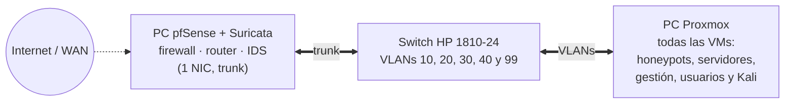

# 🍯 HoneyNet

Este repositorio de Gitbook, es un repositorio orientado a mi proyecto del segundo grado del ciclo de Administración de Sistemas Informáticos en Red (ASIR) con perfil en ciberseguridad.


**Estado actual del proyecto**: en desarrollo activo

**Fase**: F0 — Profundización y F1 — Instalación de Proxmox (en curso)


En el repositorio se incluirá la memoria del proyecto, junto a todos los aspectos y acciones que he ido tomando durante el transcurso del mismo.

## Infraestructura de un vistazo

Más detalle en [Infraestructura física](introduccion-al-proyecto/infraestructura-fisica.md) y en el [Diagrama de red](introduccion-al-proyecto/diagrama-de-red.md).
