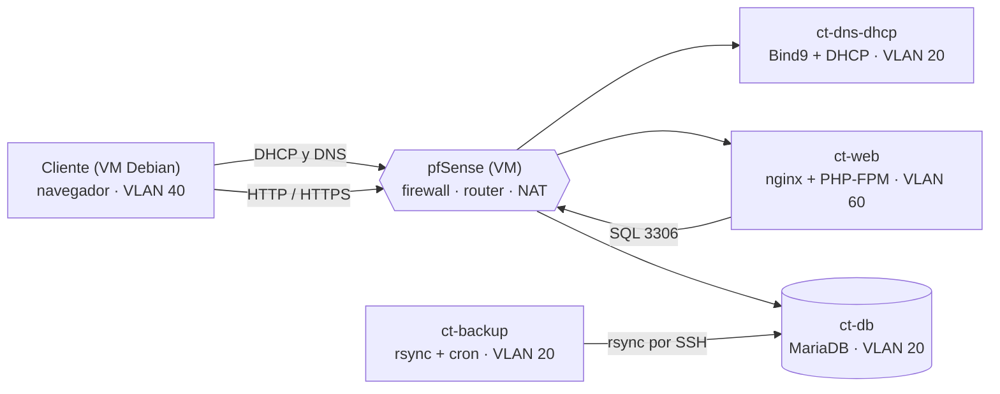

# A3 — Arquitectura del software


**Formato de entrega**: URL a este informe documentado en GitBook.


## Datos de la práctica

|                     |                                                                                                    |
| ------------------- | -------------------------------------------------------------------------------------------------- |
| **Módulo**          | M0379 / Proyecto                                                                                   |
| **Ciclo formativo** | ASIX 2º                                                                                            |
| **Alumnos**         | Alex Naranjo Blázquez y David Álvarez Fernández                                                    |
| **Proyecto**        | HoneyNet: red de laboratorio con honeypots y web de una empresa que ofrece honeypots como servicio |

***

## Objetivos

Planificar el proyecto definiendo una calendarización detallada con:

* **Objetivos** del proyecto y de cada funcionalidad.
* **Resultados a alcanzar** y su fecha aproximada de entrega.
* **Requisitos técnicos**, tanto de hardware como de software.

***

## El porqué del diseño y la arquitectura

Antes de instalar nada, conviene tener un plano de lo que se va a construir. En HoneyNet esto es especialmente importante porque el proyecto reúne virtualización, red segmentada, servicios, seguridad y una aplicación web que depende de todo lo anterior.

* **Mitigar riesgos**: decidir con antelación qué servidor puede hablar con cuál evita errores de seguridad, como que la base de datos sea accesible desde fuera.
* **Escalabilidad y mantenimiento**: separar web, base de datos, DNS/DHCP y copias en contenedores distintos permite actualizar o sustituir una pieza sin tocar las demás.
* **Optimizar recursos**: el laboratorio corre sobre dos PCs con Proxmox, con solo 8 GB de RAM y un SSD de 128 GB cada uno; saber cuánta CPU, RAM y disco necesita cada máquina evita quedarse sin recursos a mitad de proyecto.
* **Trabajo en equipo**: con dos personas, los diagramas y las tablas de requisitos hacen que ambos entendamos el mismo objetivo y nos repartamos las tareas.

***

## Resumen de la arquitectura

La arquitectura es **cliente-servidor**. Un cliente en la VLAN de Usuarios obtiene su IP por DHCP, resuelve el dominio con el DNS propio y accede por navegador a la web, que consulta la base de datos. Todo el tráfico entre VLANs pasa por pfSense.

***

## Demostración «Hello world»

La evaluación consiste en una demostración funcional de un «Hello world» sobre la infraestructura diseñada.

### Qué se va a demostrar

1. El cliente arranca y recibe su IP, máscara, puerta de enlace y DNS por **DHCP**.
2. El cliente resuelve el dominio propio con el **DNS** del proyecto.
3. Desde el **navegador del cliente** se abre la web de prueba servida por nginx con el dominio personalizado.
4. Desde una máquina de la red real del centro se abre la misma web gracias al reenvío de puertos de pfSense.

### Niveles de la rúbrica

| Nota  | Nivel           | Qué se conseguirá                                                                          |
| ----- | --------------- | ------------------------------------------------------------------------------------------ |
| 2 p   | Satisfactorio   | Acceso a la web de prueba mediante dominio personalizado desde una máquina de la red real. |
| 1,5 p | Bien            | Acceso mediante dominio personalizado desde el navegador de una máquina virtual.           |
| 1 p   | Necesita mejora | Acceso a la web de prueba mediante `localhost` desde la máquina virtual.                   |
| 0 p   | Insatisfactorio | No se cumple ninguno de los requisitos o no se ha realizado a tiempo.                      |

***

## Índice del informe

1. [Planificación y funcionalidades](1.-planificacion-y-funcionalidades.md)
2. [Arquitectura del sistema](2.-arquitectura-del-sistema.md)
3. [Diagrama de la base de datos](3.-diagrama-de-la-base-de-datos.md)
4. [Desarrollo y diseño UI/UX](4.-desarrollo-y-diseno-ui-ux.md)
5. [Infraestructura y red (Proxmox)](5.-infraestructura-y-red-proxmox.md)
6. [Seguridad](6.-seguridad.md)
