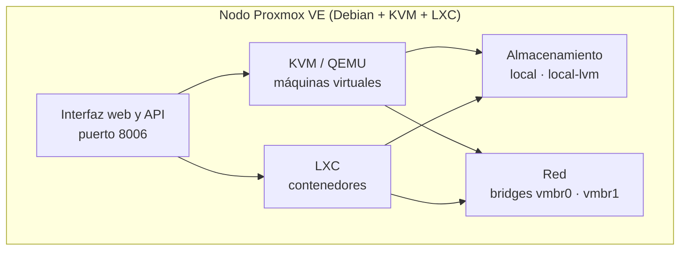

# Proxmox en detalle

## Introducción

Esta página amplía el [Bloque 1 — Proxmox](./). Allí se explica por qué se usa Proxmox y qué es un nodo, una VM, un bridge, un snapshot o una plantilla. Aquí se recoge **cómo funciona por dentro** y qué otras piezas tiene, para entender las decisiones que se toman luego en la implementación.

***

## 1. Qué es Proxmox VE

**Proxmox VE** (_Virtual Environment_) es una plataforma de virtualización de código abierto basada en **Debian GNU/Linux**. Se instala directamente sobre el hardware, sin otro sistema operativo debajo (un hipervisor de tipo 1, o _bare-metal_), y junta en una sola herramienta dos tecnologías y un panel de gestión.

Es gratuito. La suscripción de pago solo da acceso a un repositorio de actualizaciones más probado y a soporte técnico; el software es el mismo. En el laboratorio se usa **Proxmox VE 9**, que se basa en Debian 13.

| Pieza                  | Qué es                                           | Para qué sirve                                     |
| ---------------------- | ------------------------------------------------ | -------------------------------------------------- |
| **KVM y QEMU**         | Virtualización completa apoyada en el procesador | Máquinas virtuales con su propio kernel            |
| **LXC**                | Contenedores de sistema Linux                    | Servicios ligeros que comparten el kernel del nodo |
| **Interfaz web y API** | Un panel en el puerto 8006 por HTTPS             | Gestionarlo todo desde el navegador o con scripts  |
| **Almacenamiento**     | `local`, LVM-thin, ZFS, NFS...                   | Guardar discos, ISOs, plantillas y copias          |
| **Red**                | Bridges de Linux con soporte de VLANs            | Conectar las máquinas entre sí y con el exterior   |

## 2. Hipervisor de tipo 1 y de tipo 2

|                 | Tipo 2 (por ejemplo, VirtualBox)                          | Tipo 1 (Proxmox)                                |
| --------------- | --------------------------------------------------------- | ----------------------------------------------- |
| Dónde corre     | Como un programa dentro de otro sistema (Windows o Linux) | Directamente sobre el hardware                  |
| Consumo propio  | El sistema base gasta RAM y CPU de fondo                  | Solo gasta lo que necesita el propio Proxmox    |
| Rendimiento     | Menor                                                     | Mayor                                           |
| Gestión         | Un programa de escritorio                                 | Un servidor que se administra por la web        |
| Cuándo conviene | Probar algo en un portátil                                | Un laboratorio que debe estar siempre encendido |

## 3. Almacenamiento

Proxmox separa **dónde se guardan los archivos** y **dónde se guardan los discos de las máquinas**.

| Tipo                       | Qué es                                   | Cuándo se usa                                        |
| -------------------------- | ---------------------------------------- | ---------------------------------------------------- |
| **Directory** (`local`)    | Una carpeta del sistema                  | ISOs, plantillas de contenedor y copias de seguridad |
| **LVM-thin** (`local-lvm`) | Un volumen con aprovisionamiento ligero  | Discos de VMs y contenedores, y snapshots rápidos    |
| **ZFS**                    | Sistema de archivos con muchas funciones | Potente, pero gasta mucha RAM: no conviene con 8 GB  |
| **NFS**                    | Una carpeta compartida por red           | Copias o ISOs en otro servidor                       |

Con el **aprovisionamiento ligero** (_thin_), un disco de 8 GB solo ocupa en el nodo lo que realmente se ha escrito en él. Es muy cómodo, pero hay que vigilar que la suma de lo prometido no llene el disco real.

En el laboratorio, el PC 1 tiene `local` y `local-lvm` en un SSD de 128 GB (unos 54 GB para máquinas). El PC 2 tiene un disco duro de 500 GB con Proxmox y un SSD de 256 GB que se añade como almacenamiento aparte, para las máquinas que más escriben.


CAPTURA PENDIENTE: _Datacenter → Storage_ con los almacenamientos de los dos nodos.


## 4. Red

Un **bridge** (`vmbr`) es un switch virtual. Cuando es _VLAN aware_, deja pasar tráfico etiquetado y cada máquina elige su VLAN con la etiqueta de su tarjeta.

| Bridge  | Tarjeta física | Para qué se usa                                                     |
| ------- | -------------- | ------------------------------------------------------------------- |
| `vmbr0` | Sí             | La red del centro y la gestión del nodo. No se modifica a distancia |
| `vmbr1` | No             | Red interna aislada con VLANs, para las máquinas del proyecto       |

Una tarjeta de red de una VM o de un contenedor se conecta a un bridge y, si hace falta, lleva una etiqueta de VLAN. Dos máquinas en el mismo bridge y la misma VLAN se ven; en VLANs distintas no, mientras no haya un router entre ellas.

## 5. Snapshots y copias de seguridad

|                           | Snapshot                           | Copia de seguridad (`vzdump`)  |
| ------------------------- | ---------------------------------- | ------------------------------ |
| Qué es                    | Foto del estado, en el mismo disco | Archivo completo de la máquina |
| Velocidad                 | Inmediata                          | Más lenta                      |
| Sirve para                | Volver atrás tras un cambio        | Recuperar una máquina perdida  |
| Protege si el disco falla | No                                 | Sí, si se guarda fuera         |

Las copias tienen tres **modos**: _Snapshot_ (con la máquina encendida, el más usado), _Suspend_ (la pausa un momento) y _Stop_ (la apaga durante la copia). Se pueden programar y limitar cuántas se conservan.

## 6. Usuarios y seguridad

* **`root`** del nodo lo puede todo, así que se trabaja con un usuario propio con el rol _Administrator_.
* Los usuarios viven en un **realm**: _Linux PAM_ (los del sistema) o _Proxmox VE authentication server_ (propios de Proxmox).
* Los **roles** (como _Administrator_ o _PVEAuditor_) se asignan por ruta, de modo que un usuario puede ver solo una parte.
* Se puede activar un **segundo factor** (TOTP) para cada usuario.
* Proxmox trae un **firewall integrado**, que se puede aplicar al nodo o a cada máquina. En el laboratorio no se usa porque ese papel lo hace pfSense.

## 7. Clúster y alta disponibilidad

Proxmox permite agrupar varios nodos en un **clúster**, para administrarlos juntos, mover máquinas entre ellos y reiniciarlas solas si un nodo cae (_alta disponibilidad_). Para decidir con seguridad cuál sigue en pie, el clúster necesita **quórum** (mayoría de votos), así que se recomiendan tres nodos; con dos hace falta un tercer voto auxiliar.

En HoneyNet **no se usa**: son **dos nodos independientes**, cada uno con sus máquinas. Con solo dos PCs prestados y poca memoria, un clúster aportaría más problemas que ventajas.

## 8. Cómo se usa en HoneyNet

| Nodo        | Equipo                                                   | Aloja                                                      |
| ----------- | -------------------------------------------------------- | ---------------------------------------------------------- |
| `honeynet`  | PC 1 (8 GB de RAM, SSD de 128 GB)                        | pfSense con Suricata, honeypots, servidores, web y cliente |
| `honeynet2` | PC 2 (8 GB de RAM, disco duro de 500 GB y SSD de 256 GB) | El SIEM (Wazuh y Grafana) y Kali                           |

Las máquinas se crean a partir de **plantillas**, los servicios ligeros van en **contenedores** y el aislamiento entre zonas lo hacen las VLANs y pfSense. La implementación paso a paso está en [Implementación en Proxmox](../../implementacion-en-proxmox/).

## 9. Comandos útiles de la consola del nodo

| Comando                        | Qué hace                                          |
| ------------------------------ | ------------------------------------------------- |
| `pveversion`                   | Muestra la versión de Proxmox                     |
| `qm list`                      | Lista las máquinas virtuales                      |
| `qm start 100` y `qm stop 100` | Enciende y apaga la VM con ese número             |
| `pct list`                     | Lista los contenedores                            |
| `pct enter 101`                | Abre una consola dentro del contenedor            |
| `pvesm status`                 | Muestra los almacenamientos y su espacio          |
| `vzdump 101`                   | Hace una copia de seguridad ahora                 |
| `bridge link`                  | Muestra qué interfaces están unidas a cada bridge |

## 10. Buenas prácticas

* **No tocar `vmbr0`** si no se tiene acceso físico al equipo: un error corta el acceso.
* Usar el repositorio **gratuito** y desactivar los de pago.
* **Evitar ZFS** con poca memoria.
* Dejar las plantillas **limpias** (sin identificador de equipo ni claves SSH) y probar un clon.
* Los cambios de red de un contenedor se aplican **al arrancarlo**: apagarlo del todo, no solo reiniciarlo.
* Guardar al menos una **copia fuera del equipo**.
* Actualizar, pero **reiniciar solo cuando se pueda acceder al PC**.

## Webgrafía

* [Documentación oficial de Proxmox VE](https://pve.proxmox.com/pve-docs/)
* [Proxmox VE: página del producto](https://www.proxmox.com/en/products/proxmox-virtual-environment/overview)
