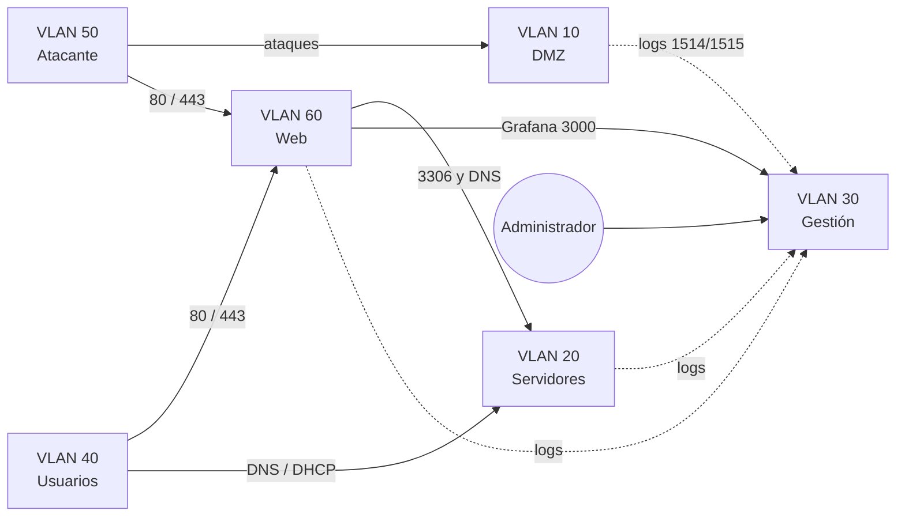

# Bloque 3 — VLANs aplicadas a seguridad

## **VLANs aplicadas a seguridad**

La parte técnica (crear VLANs, etiquetado 802.1Q) ya se conoce de primer curso. Lo nuevo aquí es el **razonamiento de seguridad** detrás de cada VLAN y los ataques que hay que prevenir al segmentar.

### Por qué segmentamos

En una red plana, un atacante que comprometa el honeypot (que está ahí precisamente para ser atacado) tendría visibilidad directa sobre los servidores reales, el SIEM y todo lo demás. **Segmentar significa que comprometer una pieza no da acceso a las demás.**


Una VLAN separa el tráfico a nivel 2, pero **no filtra nada por sí sola**. Lo que impide que dos VLANs hablen entre sí es el firewall (pfSense) que las enruta. VLAN = separación; reglas del firewall = seguridad.


### Cada VLAN, con su lógica



**Qué es**: la entrada desde la red real del centro, es decir, todo lo que viene de fuera del laboratorio.

**Regla clave**: nada de fuera llega directamente a las VLANs internas. Solo se publica lo imprescindible, y siempre pasando por pfSense.

**Por qué**: es la zona en la que no se confía en nada.



**Qué vive aquí**: los honeypots (Cowrie, Dionaea y DVWA), en Docker dentro de una VM del PC 1.

**Regla clave**: es la zona más hostil, a propósito: aquí sí entra tráfico atacante. Pero esta VLAN **nunca inicia conexiones hacia otra VLAN**, salvo enviar logs a Gestión (puertos 1514 y 1515).

**Por qué**: si un honeypot se compromete de verdad, que es justo lo que se busca, el atacante queda atrapado ahí. No necesita base de datos: los ataques los guarda Wazuh.



**Qué vive aquí**: los servicios internos, cada uno en su contenedor: DNS y DHCP, base de datos MariaDB y copias de seguridad.

**Regla clave**: solo se accede desde Usuarios (DNS y DHCP), desde Web (base de datos y DNS) y desde Gestión. **Nunca desde la DMZ ni desde el atacante.**

**Por qué**: son los servicios sobre los que se apoya todo lo demás, así que no deben ser alcanzables desde las zonas expuestas.



**Qué vive aquí**: Wazuh (SIEM) y Grafana, en el PC 2.

**Regla clave**: es la VLAN más protegida. Recibe logs de las demás VLANs (tráfico de monitorización, permitido y en un solo sentido), pero nadie inicia conexión hacia aquí salvo el administrador. La única excepción es la web hacia Grafana (puerto 3000).

**Por qué**: quien controla el SIEM ve todo lo que pasa en el laboratorio.



**Qué vive aquí**: una VM que simula a un empleado.

**Regla clave**: consume DNS y DHCP de la VLAN 20 y visita la web (80 y 443), pero no tiene motivo para tocar la DMZ ni la Gestión.

**Por qué**: los usuarios son un punto de entrada habitual de ataques reales, así que se les da solo lo que necesitan.



**Qué vive aquí**: Kali Linux, en el PC 2, encendida solo durante las pruebas.

**Regla clave**: simula internet hostil. Puede atacar la DMZ y probar la web (80 y 443), pero nunca llegar a Servidores, Gestión ni Usuarios.

**Por qué**: sirve para comprobar que las reglas funcionan, atacando desde fuera como lo haría un tercero.



**Qué vive aquí**: el servidor web de la empresa (nginx y PHP-FPM) en un contenedor.

**Regla clave**: solo habla con la base de datos (3306), el DNS (53) y Grafana (3000), y envía sus logs a Gestión.

**Por qué**: la web es la pieza más expuesta a visitantes. Si se comprometiera, el daño se limita a lo que esas pocas reglas permiten.



### Mapa de los flujos permitidos

Todo lo que no aparece en el mapa está **bloqueado**: el firewall deniega por defecto y solo se abre lo que tiene una razón. La tabla completa de reglas está en el [Diagrama de red](../introduccion-al-proyecto/diagrama-de-red.md).

### El concepto que lo resume todo: defensa en profundidad

No se depende de una sola barrera. Aunque pfSense tuviera un fallo, o un honeypot se comprometiera de verdad, las demás capas siguen en pie:

* **Segmentación** en VLANs.
* **Reglas del firewall** entre VLANs, con denegación por defecto.
* **Firewall en cada servidor** (UFW) con mínimo privilegio.
* **IDS** (Suricata) mirando el tráfico que pasa.
* **Monitorización** (Wazuh) que lo registra todo.

Es el razonamiento que más valora un tribunal, porque demuestra que las VLANs no se montaron «porque sí», sino con una razón de seguridad detrás de cada una.

### Cómo se ataca una VLAN: VLAN hopping

Segmentar no es suficiente si el propio switch está mal configurado. El **VLAN hopping** es el conjunto de técnicas con las que un atacante salta de su VLAN a otra sin pasar por el firewall.



**Cómo funciona**: el atacante hace que su equipo se comporte como un switch y negocia un enlace **trunk** con el switch real. Con el trunk formado, recibe el tráfico de todas las VLANs permitidas en él.

**Cuándo es posible**: cuando el puerto está en un modo que acepta negociar trunks automáticamente.

**Cómo se previene**:

* Desactivar la negociación automática de trunks en los puertos que no la necesitan.
* Configurar como puertos de acceso todos los puertos que no sean un trunk.
* Apagar los puertos que no se usan.



**Cómo funciona**: el atacante envía una trama con **dos etiquetas** 802.1Q. La externa coincide con la VLAN nativa del trunk, así que el primer switch la quita y reenvía la trama con la etiqueta interna, que apunta a la VLAN víctima.

**Características**: solo funciona si el atacante está en la VLAN nativa y es **unidireccional**: la respuesta no puede volver.

**Cómo se previene**:

* No colocar equipos en la VLAN 1 (la VLAN por defecto).
* Usar como VLAN nativa de los trunks un identificador que no se use para nada.
* Etiquetar explícitamente la VLAN nativa en los trunks y no asignar nunca puertos de acceso a ella.



Aunque no son VLAN hopping en sentido estricto, las redes segmentadas también sufren:

* **ARP spoofing**: suplantar a otro equipo para interceptar su tráfico dentro de la misma VLAN.
* **DHCP spoofing**: un servidor DHCP falso que reparte configuraciones de red manipuladas.
* **Desbordamiento de la tabla MAC**: saturar al switch para que reenvíe el tráfico por todos sus puertos.

Se reducen limitando quién tiene acceso físico a los puertos, apagando los que no se usan y manteniendo el firmware del switch actualizado.



### Qué se aplicará en el switch

| Riesgo                   | Medida en el HP 1810-24                                                                        |
| ------------------------ | ---------------------------------------------------------------------------------------------- |
| Switch spoofing          | Solo dos puertos en trunk, los de los PCs 1 y 2; el resto en modo acceso, cada uno en su VLAN. |
| Double tagging           | No usar la VLAN 1 para ningún equipo y dejar como VLAN nativa de los trunks una VLAN sin uso.  |
| Puertos libres           | Apagarlos o dejarlos en una VLAN sin uso.                                                      |
| Acceso de administración | Un único puerto en la VLAN 30 (Gestión).                                                       |
| Fallos conocidos         | Cambiar las credenciales por defecto y mantener el firmware actualizado.                       |


La negociación automática de trunks (DTP) es un protocolo propio de Cisco, y en un switch HP cada puerto se configura a mano. Aun así, la regla es la misma: ningún puerto debe quedar en un modo que acepte un trunk sin que lo hayas configurado tú. Se comprobará en la interfaz del switch durante la Fase 2.


### Qué NO protege una VLAN

* **No cifra el tráfico**: dentro de una VLAN, quien tenga acceso puede capturarlo.
* **No sustituye al firewall**: sin reglas entre VLANs, el router las comunica sin restricción.
* **No frena el acceso físico**: un cable conectado a un puerto mal configurado salta cualquier segmentación.

### Para ampliar

* [VLAN hopping — TechTarget](https://www.techtarget.com/cybersecurity/definition/virtual-local-area-network-hopping-VLAN-hopping)
* [VLAN hopping 101 — ManageEngine](https://www.manageengine.com/network-monitoring/vlan-hopping.html)
* [VLAN hopping y mitigación — LevelBlue](https://levelblue.com/blogs/levelblue-blog/vlan-hopping-and-mitigation)

### Próximos pasos

Seguir con el [Bloque 4 — Stack de servicios completo](bloque-4-stack-de-servicios-completo.md). La configuración real del switch y de las reglas de pfSense se hará en la Fase 2.
