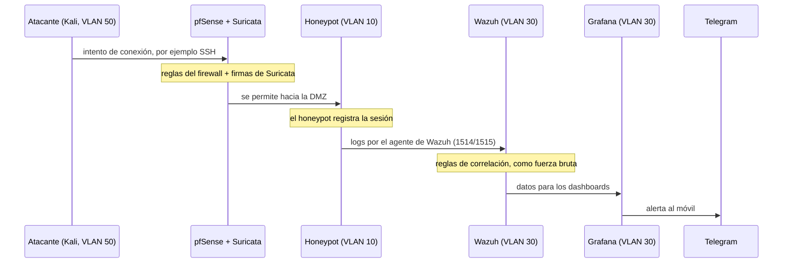

# Bloque 4 — Stack de servicios completo

## **Stack de servicios**

No hace falta saber instalar cada servicio todavía (eso es de cada fase), pero sí entender **qué hace, por qué está ahí y dónde vive**, para que al llegar a su fase no se empiece de cero.

### Vista general

| Capa               | Servicio                       | Dónde vive                        | Fase           |
| ------------------ | ------------------------------ | --------------------------------- | -------------- |
| Red y seguridad    | pfSense                        | VM en el PC 1                     | F2             |
| Red y seguridad    | Suricata                       | Dentro de pfSense                 | F2             |
| Servicios internos | Bind9 y Kea (DNS y DHCP)       | Contenedor `ct-dns-dhcp`, VLAN 20 | F3             |
| Servicios internos | MariaDB                        | Contenedor `ct-db`, VLAN 20       | F3             |
| Servicios internos | rsync + cron                   | Contenedor `ct-backup`, VLAN 20   | F3             |
| Servicios internos | nginx + PHP-FPM                | Contenedor `ct-web`, VLAN 60      | F3             |
| Honeypots          | Cowrie, Dionaea y DVWA         | VM con Docker en el PC 1, VLAN 10 | F4             |
| Monitorización     | Wazuh                          | VM del SIEM en el PC 2, VLAN 30   | F5             |
| Monitorización     | Grafana y alertas por Telegram | VM del SIEM en el PC 2, VLAN 30   | F6             |
| Pruebas            | Kali Linux                     | VM en el PC 2, VLAN 50            | F2 en adelante |

### Red y seguridad perimetral



**Qué es**: un firewall y router de código abierto con interfaz web, basado en FreeBSD.

**Qué hace aquí**: hace de «aduana» entre todas las VLANs. Decide qué tráfico pasa y cuál no según las reglas definidas por interfaz, con denegación por defecto. También hace NAT y reenvía las peticiones DHCP de los clientes hacia el servidor de la VLAN 20 (DHCP relay).

**Dónde vive**: en una VM del PC 1, con las VLANs llegando por trunk desde el switch.



**Qué es**: un motor de detección de intrusiones (IDS) que se instala como paquete dentro de pfSense.

**Qué hace aquí**: analiza en tiempo real el tráfico que cruza el firewall y lo compara con miles de firmas de ataques conocidos (las reglas Emerging Threats Open, gratuitas). Si detecta un patrón sospechoso, genera una alerta.

**Detalle**: en modo IDS solo avisa; en modo IPS también bloquea. En este proyecto se usa para detectar y registrar, no para frenar el ataque, porque el objetivo es estudiarlo.



### Servicios internos



**Qué es**: el servidor DNS más usado de internet.

**Qué hace aquí**: traduce nombres a IPs dentro de la red. En vez de recordar una IP, se escribe un nombre como `www.honeypot.com`.

**Dónde vive**: en `ct-dns-dhcp` (VLAN 20), con un servidor maestro y uno esclavo. Ya hay dos guías en estos apuntes: [Servidor DNS con Bind9](../../apuntes-asix/servicios-de-red/dns/servidor-dns-con-bind9-en-debian-13-trixie.md) y [Servidor DNS esclavo](../../apuntes-asix/servicios-de-red/dns/servidor-dns-esclavo-slave-con-bind9-en-debian-13-trixie.md).

**Puerto**: 53, TCP y UDP.



**Qué es**: el servidor DHCP actual de ISC. Sustituye a ISC DHCP (`isc-dhcp-server`), que dejó de mantenerse a finales de 2022.

**Qué hace aquí**: reparte IPs a los equipos de la VLAN de Usuarios, junto con la puerta de enlace y el DNS que deben usar. Su configuración es en formato JSON y tiene API REST.

**Dónde vive**: en `ct-dns-dhcp` (VLAN 20). Como los clientes están en otra VLAN, pfSense hace de relay entre ambas.

**Puertos**: 67 y 68, UDP.



**Qué es**: un servidor de bases de datos relacionales, compatible con MySQL.

**Qué hace aquí**: guarda el contenido de la web de la empresa: planes, sectores, mensajes del formulario de contacto y cuentas de administrador. Permite consultas estructuradas en vez de buscar a mano en archivos.

**Dónde vive**: en `ct-db` (VLAN 20). Solo acepta conexiones del servidor web.

**Puerto**: 3306.



**Qué son**: `rsync` copia y sincroniza archivos enviando solo lo que ha cambiado; `cron` es el planificador de tareas de Linux.

**Qué hacen aquí**: copias de seguridad automáticas por la noche de lo que no se puede perder: el volcado de MariaDB y las configuraciones.

**Dónde viven**: en `ct-backup` (VLAN 20).



**Qué son**: nginx es un servidor web ligero; PHP-FPM ejecuta el código PHP que nginx le pasa.

**Qué hacen aquí**: sirven la web de la empresa y su lógica (formulario de contacto, planes, login de administrador). También actúan de proxy hacia Grafana para el panel de administración.

**Dónde viven**: en `ct-web` (VLAN 60).

**Puertos**: 80 y 443.



### Honeypots



**Qué es**: un honeypot de interacción media para SSH y Telnet. Emula un sistema Unix en Python con un sistema de archivos falso.

**Qué registra**: la IP, los usuarios y contraseñas probados, los comandos ejecutados y los archivos que el atacante descarga o sube. Guarda los eventos en JSON y las sesiones completas, que se pueden **reproducir como un vídeo de terminal** con la herramienta `playlog`.

**Puertos**: por defecto escucha en el 2222 (SSH) y en el 2223 (Telnet); en Docker se publican como 22 y 23 para que el atacante crea estar en un servidor real.



**Qué es**: un honeypot de baja interacción cuyo objetivo es **capturar el malware** que explota servicios vulnerables.

**Qué emula**: SMB (su protocolo principal, muy atacado por gusanos), FTP, HTTP, TFTP, Microsoft SQL Server, MySQL y SIP, entre otros. Detecta shellcode y guarda una copia de lo que el atacante intenta soltar.

**Detalle**: también emula HTTP, y DVWA usa el puerto 80, así que esa convivencia se resuelve en el `docker-compose` de la Fase 4.



**Qué es**: _Damn Vulnerable Web Application_, una aplicación web hecha a propósito con fallos de seguridad (inyección SQL, XSS, fuerza bruta...).

**Qué aporta aquí**: no captura malware, sino **técnicas de explotación web**: qué payloads prueban los atacantes contra una aplicación vulnerable.

**Puerto**: 80.



### Monitorización y respuesta



**Qué es**: el SIEM del proyecto, una plataforma de código abierto de seguridad.

**Sus piezas**:

* **Agente**: se instala en cada equipo vigilado y envía los eventos al servidor.
* **Servidor**: decodifica los eventos y aplica las reglas de correlación.
* **Indexer**: guarda y indexa los datos (basado en OpenSearch).
* **Dashboard**: interfaz web para consultar y visualizar.

**Qué hace aquí**: centraliza los logs de Cowrie, Dionaea, DVWA, Suricata y los servidores, y detecta patrones. Por ejemplo, **fuerza bruta** = muchos intentos fallidos en poco tiempo desde la misma IP. Es también donde se guardan los ataques capturados.

**Puertos**: 1514 (los agentes envían eventos), 1515 (alta de agentes), 55000 (API), 9200 (indexer) y 443 (dashboard). Las comunicaciones entre agente y servidor van cifradas.

**Despliegue**: para laboratorios y entornos pequeños se instala todo en una sola máquina (_all-in-one_), que es lo que se hará aquí.



**Qué es**: una herramienta para crear gráficas, mapas y paneles a partir de datos.

**Qué hace aquí**: convierte los datos de Wazuh en dashboards (ataques por país, por hora, por honeypot) y en una tabla de logs. No analiza nada, **solo visualiza**. Esos paneles se incrustan en la zona de administración de la web.

**Cómo se conecta**: lee de Wazuh a través del indexer, que es OpenSearch, mediante una fuente de datos de Grafana.

**Puerto**: 3000.



**Qué es**: un servicio de mensajería con una API para bots.

**Qué hace aquí**: Grafana envía las alertas al móvil mediante un bot de Telegram cuando se cumple una condición, por ejemplo una oleada de intentos de fuerza bruta.



**Qué es**: una distribución de Linux con herramientas de pruebas de seguridad.

**Qué hace aquí**: es el atacante controlado. Se enciende solo en las pruebas, desde la VLAN 50, para lanzar ataques contra la DMZ y la web y comprobar que todo se detecta y se registra.



### Cómo viaja un ataque por el stack

Las alertas de Suricata también deben llegar a Wazuh; Wazuh puede recibir logs de firewalls por syslog, y cómo se conectará se decide en la Fase 5.

### Dónde se guarda cada cosa

| Dato                                           | Dónde se guarda                           |
| ---------------------------------------------- | ----------------------------------------- |
| Contenido de la web y cuentas de administrador | MariaDB (`ct-db`)                         |
| Ataques capturados                             | Wazuh (indexer)                           |
| Logs y sesiones originales de los honeypots    | Volúmenes de Docker en la VM de honeypots |
| Muestras de malware                            | Volumen de Dionaea                        |
| Copias de seguridad                            | `ct-backup`, con rsync nocturno           |
| Gráficos y paneles                             | Grafana, que lee de Wazuh                 |


Wazuh en una sola máquina recomienda, para hasta 25 agentes, 4 vCPU, 8 GB de RAM y 50 GB de disco. La VM del SIEM está prevista con 4 GB de RAM y 30 GB, la mitad de lo recomendado, y el indexer es la pieza que más memoria consume. Habrá que ajustar la memoria del indexer, ampliar la RAM si el PC 2 lo permite o reducir los días de retención.


### Para ampliar

* [Arquitectura de Wazuh](https://documentation.wazuh.com/current/getting-started/architecture.html)
* [Requisitos de Wazuh (quickstart)](https://documentation.wazuh.com/current/quickstart.html)
* [Cowrie, repositorio y documentación](https://github.com/cowrie/cowrie)
* [Dionaea, repositorio](https://github.com/DinoTools/dionaea)
* [Dionaea: de Conficker a WannaCry — The Honeynet Project](https://honeynet.org/2017/05/30/dionaea-honeypot-from-conficker-to-wannacry-sambacry-cve-2017-7494/)
* [Fin de mantenimiento de ISC DHCP — ISC](https://isc.org/dhcp/)
* [Kea DHCP — ISC](https://www.isc.org/kea/)

### Próximos pasos

Con los cuatro bloques de la Fase 0 completos, se puede pasar a la Fase 1. Los servicios se irán instalando fase a fase.
