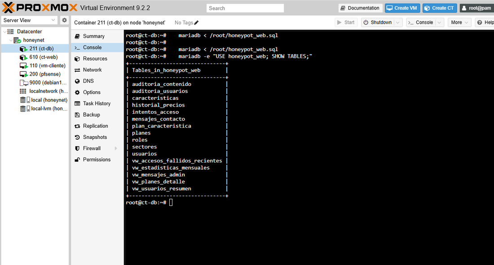

# Base de datos

En `ct-db` se instala MariaDB, que escucha solo en su IP interna, y se carga el script `honeypot_web.sql`, que crea las tablas, las vistas, los procedimientos, los triggers y los eventos. La web usa un usuario que solo puede ejecutar procedimientos (ver [Diagrama de la base de datos](../../introduccion-al-proyecto/arquitectura-del-software/3.-diagrama-de-la-base-de-datos.md)).

<figure><figcaption></figcaption></figure>
