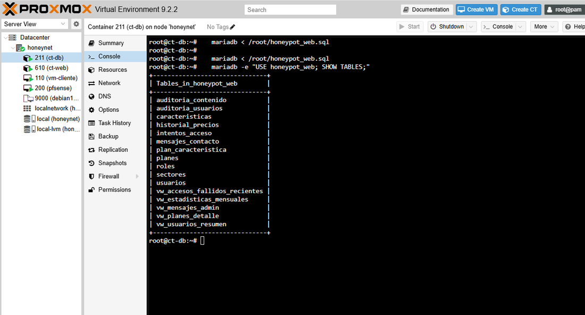

# Base de datos

En `ct-db` se instala MariaDB, que escucha solo en su IP interna, y se carga el script `honeypot_web.sql`, que crea las tablas, las vistas, los procedimientos, los triggers y los eventos. La web usa un usuario que solo puede ejecutar procedimientos (ver [Diagrama de la base de datos](../../../introduccion-al-proyecto/arquitectura-del-software/3.-diagrama-de-la-base-de-datos.md)).

<figure><figcaption></figcaption></figure>

## <mark style="color:$warning;">**Pruebas con datos de ejemplo**</mark>

Para comprobar que todo funciona se usa el script `honeypot_web_pruebas.sql`. Inventa datos (mensajes, un administrador, intentos de login, planes nuevos) y llama a cada procedimiento y a cada trigger. También lanza a propósito los casos que deben fallar, que son los marcados con `-- error` en el script: un error en esos casos es el resultado correcto.

Se ejecuta desde la consola de `ct-db`, fuera de `mysql`, en la carpeta donde esté el script:

```bash
mariadb -t --force -u root < honeypot_web_pruebas.sql | less -S
```

`-t` muestra los resultados en tablas, `--force` hace que siga aunque una prueba dé error a propósito y `-S` evita que se parta la línea en las tablas anchas. Se sale de `less` con `q`.


CAPTURA PENDIENTE: el comando ejecutado y el principio de la salida.


### <mark style="color:$warning;">**Bloque 1: zona pública**</mark>

Se llama a `sp_listar_planes` y `sp_listar_sectores`. Deben salir los planes con sus características y los sectores.


CAPTURA PENDIENTE: bloque 1, planes y sectores.


### <mark style="color:$warning;">**Bloque 2: función del precio anual**</mark>

Se prueba `fn_precio_anual`. Devuelve el precio anual con descuento, y vacío para el plan «a consultar».


CAPTURA PENDIENTE: bloque 2, resultado de la función.


### <mark style="color:$warning;">**Bloque 3: formulario con mensajes correctos**</mark>

Se guardan los dos mensajes y el trigger limpia los espacios sobrantes del nombre.


CAPTURA PENDIENTE: bloque 3, mensajes guardados.


### <mark style="color:$warning;">**Bloque 4: formulario con datos incorrectos**</mark>

Deben dar error el mensaje demasiado corto, el teléfono no válido y el plan inexistente.


CAPTURA PENDIENTE: bloque 4, los tres errores.


### <mark style="color:$warning;">**Bloque 5: anti-spam**</mark>

Los tres primeros mensajes del mismo teléfono pasan y el cuarto se rechaza.


CAPTURA PENDIENTE: bloque 5, el cuarto mensaje rechazado.


### <mark style="color:$warning;">**Bloque 6: alta de administradores**</mark>

El admin se crea con el email normalizado. Una contraseña sin cifrar y un email falso dan error.


CAPTURA PENDIENTE: bloque 6, alta correcta y los dos errores.


### <mark style="color:$warning;">**Bloque 7: bloqueo del login**</mark>

Con cuatro fallos el usuario aún entra. Con el quinto la cuenta se bloquea. Al desbloquearla se puede entrar y se anota el último acceso.


CAPTURA PENDIENTE: bloque 7, el bloqueo tras el quinto fallo.



CAPTURA PENDIENTE: bloque 7, la cuenta desbloqueada y el acceso correcto.


### <mark style="color:$warning;">**Bloque 8: panel de administración**</mark>

Los mensajes cambian de estado y se anota quién y cuándo. Un mensaje que no existe da error. Salen las estadísticas.


CAPTURA PENDIENTE: bloque 8, cambio de estado y estadísticas.


### <mark style="color:$warning;">**Bloque 9: gestión de planes**</mark>

Se crea un plan, se le asocian características y se cambian los precios, con su historial. Borrar un plan, usar uno desactivado o cambiar el precio de uno que no existe dan error.


CAPTURA PENDIENTE: bloque 9, el historial de precios.



CAPTURA PENDIENTE: bloque 9, el error al borrar un plan.


### <mark style="color:$warning;">**Bloque 10: último administrador**</mark>

Desactivarlo y borrarlo dan error.


CAPTURA PENDIENTE: bloque 10, los dos errores.


### <mark style="color:$warning;">**Bloque 11: contraseñas y auditoría**</mark>

El cambio con un hash válido funciona y con texto plano da error. La auditoría lista los cambios.


CAPTURA PENDIENTE: bloque 11, el error con texto plano.



CAPTURA PENDIENTE: bloque 11, las tablas de auditoría.


### <mark style="color:$warning;">**Bloque 12: mantenimiento**</mark>

Purgar con menos de 30 días da error. Con 30 días borra el mensaje archivado antiguo.


CAPTURA PENDIENTE: bloque 12, el error y la purga correcta.


### <mark style="color:$warning;">**Bloque 13: eventos y permisos**</mark>

Salen los dos eventos programados y los permisos de `web_app` y `web_admin`, que solo tienen `EXECUTE` y algún `SELECT` sobre vistas.


CAPTURA PENDIENTE: bloque 13, los eventos.



CAPTURA PENDIENTE: bloque 13, los permisos de `web_app` y `web_admin`.


### <mark style="color:$warning;">**Antes y después de las pruebas**</mark>

* **Repetirlas:** el anti-spam recuerda los teléfonos de la ejecución anterior durante 10 minutos, así que hay que esperar o limpiar antes.
* **Los datos de prueba no se quedan:** el script crea un administrador `admin` con un hash inventado. Antes de exponer la web hay que volver a dejar la base limpia.
* **Limpiar:** recargar `honeypot_web.sql` borra la base y la recrea con sus datos de ejemplo originales.

```bash
mariadb -u root < honeypot_web.sql
```
