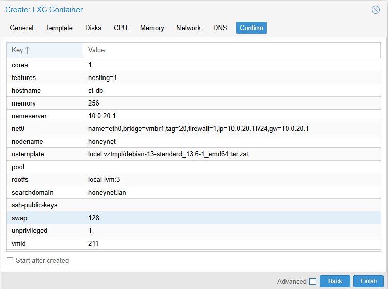
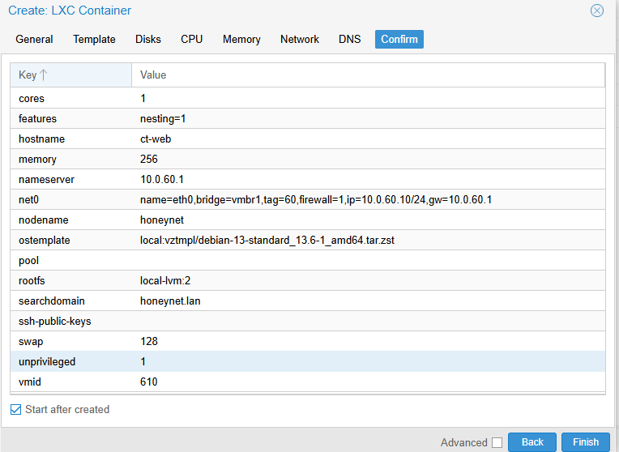
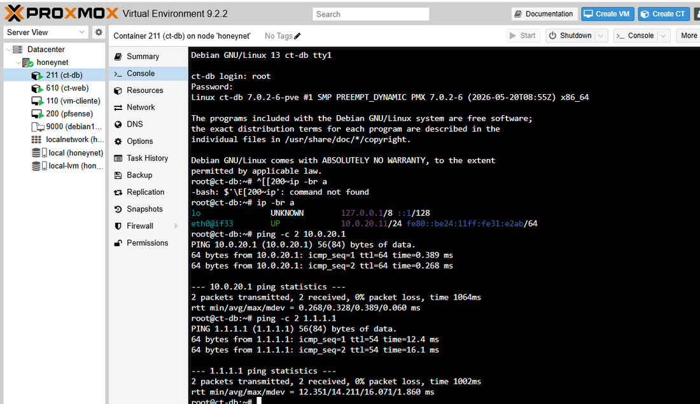
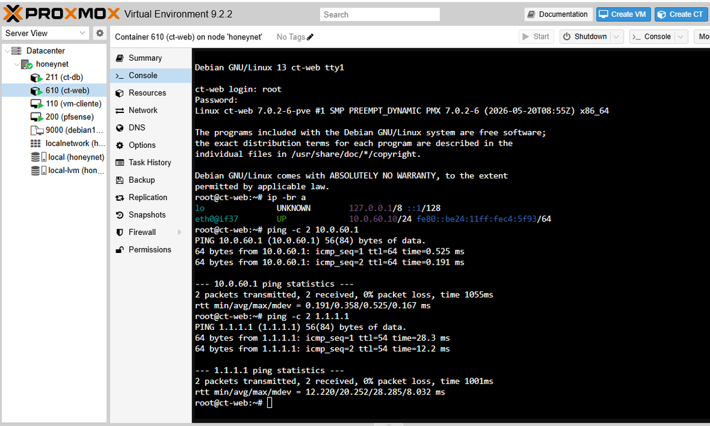

# Contenedores ct-db y ct-web

Los dos son contenedores LXC sin privilegios, con 256 MiB de RAM, en `vmbr1` con su VLAN y su IP fija, y usan a pfSense como puerta de enlace y como DNS.

| Contenedor | ID  | VLAN | IP              | Disco |
| ---------- | --- | ---- | --------------- | ----- |
| `ct-db`    | 211 | 20   | `10.0.20.11/24` | 3 GiB |
| `ct-web`   | 610 | 60   | `10.0.60.10/24` | 2 GiB |

<figure><figcaption></figcaption></figure>

<figure><figcaption></figcaption></figure>

## <mark style="color:$warning;">**Salida a internet**</mark>

Salen a internet a través de pfSense, sin tarjetas temporales: el `ping` a la puerta de enlace y a `1.1.1.1` responde y `apt update` funciona.

<figure><figcaption></figcaption></figure>

<figure><figcaption></figcaption></figure>
