# Copias de seguridad con ct-backup

## <mark style="color:$warning;">**Objetivo**</mark>

Proteger los datos del proyecto ante pérdidas o ataques: una copia nocturna de la **base de datos** (`ct-db`) y de la **web** (`ct-web`), guardada en un contenedor aparte, `ct-backup`.

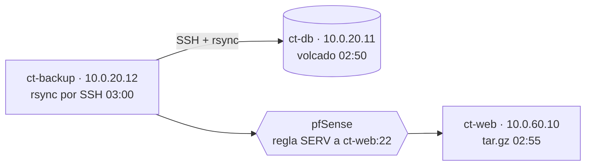

## <mark style="color:$warning;">**Por qué modelo pull**</mark>

En un modelo **push** cada servidor sube sus copias al servidor de copias, así que todos necesitan acceso a él. Si un atacante entra en uno, puede borrar también las copias. En el modelo **pull** es `ct-backup` quien entra a buscar los datos, y los servidores no tienen ninguna forma de entrar en él. Esto importa en un proyecto de honeypots, donde las máquinas expuestas pueden verse comprometidas.

## <mark style="color:$warning;">**Qué se copia y cuándo**</mark>

<table><thead><tr><th width="75">Hora</th><th width="112">Máquina</th><th width="455">Qué hace</th><th>Retención</th></tr></thead><tbody><tr><td>02:50</td><td><code>ct-db</code></td><td>Volcado de <code>honeypot_web</code> con tablas, procedimientos, triggers y eventos</td><td>7 días</td></tr><tr><td>02:55</td><td><code>ct-web</code></td><td><code>tar.gz</code> de <code>/var/www/honeynet.lan</code> y de la configuración de nginx</td><td>7 días</td></tr><tr><td>03:00</td><td><code>ct-backup</code></td><td>Recoge las copias de los dos con <code>rsync</code> por SSH</td><td>30 días</td></tr></tbody></table>

***

## **1.&#x20;**<mark style="color:$warning;">**Crear el contenedor**</mark>

Contenedor LXC sin privilegios, en la VLAN 20 junto a la base de datos.

<table><thead><tr><th width="155">Ajuste</th><th>Valor</th></tr></thead><tbody><tr><td>ID y hostname</td><td>212, <code>ct-backup</code></td></tr><tr><td>Plantilla</td><td><code>debian-13-standard_13.6-1_amd64.tar.zst</code></td></tr><tr><td>CPU y memoria</td><td>1 núcleo, 256 MiB de RAM y 256 MiB de swap</td></tr><tr><td>Disco</td><td>8 GiB en <code>local-lvm</code></td></tr><tr><td>Red</td><td><code>eth0</code>, bridge <code>vmbr1</code>, VLAN 20, <code>10.0.20.12/24</code>, gateway y DNS <code>10.0.20.1</code> (pfSense)</td></tr></tbody></table>

<figure>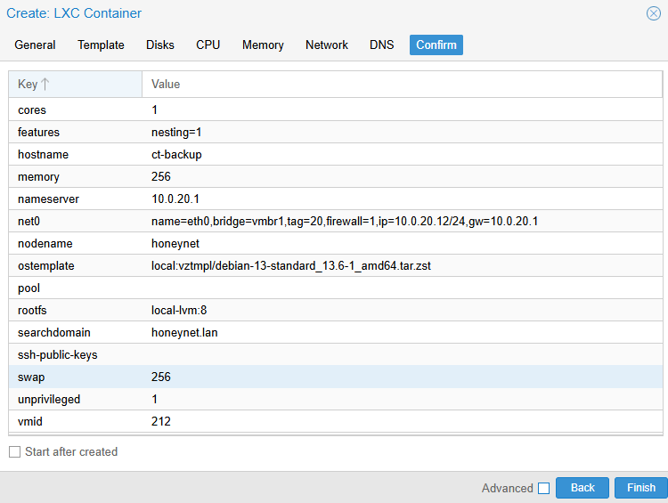<figcaption></figcaption></figure>

## **2.&#x20;**<mark style="color:$warning;">**La clave SSH**</mark>

**Concepto:** `ct-backup` se identifica ante los servidores con una clave en lugar de una contraseña, de modo que la copia nocturna funciona sin que nadie la escriba.

```bash
ssh-keygen -t ed25519 -f /root/.ssh/backup_key -N ""
```

La clave privada no sale de `ct-backup`; la pública (`backup_key.pub`) es la que se copia a los servidores.

<figure>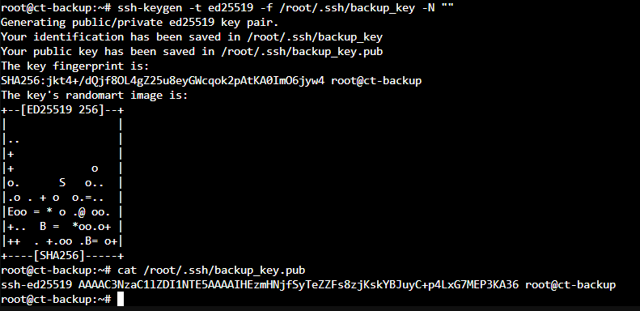<figcaption></figcaption></figure>

## **3.&#x20;**<mark style="color:$warning;">**Preparar**</mark> **`ct-db`** <mark style="color:$warning;">**y**</mark> **`ct-web`**

En los dos servidores se crea un usuario `respaldo` sin privilegios, que solo puede leer la carpeta `/var/backups/honeynet`, y se instala la clave pública con dos restricciones:

* `restrict`: anula todo lo que no sea necesario (terminal, reenvíos, etc.).
* `from="10.0.20.12"`: solo se acepta la clave si la conexión viene de `ct-backup`.

```bash
KEY='ssh-ed25519 AAAA... root@ct-backup'
apt install -y openssh-server rsync
useradd -m -s /bin/bash respaldo
mkdir -p /var/backups/honeynet && chown root:respaldo /var/backups/honeynet && chmod 750 /var/backups/honeynet
mkdir -p /home/respaldo/.ssh
echo "restrict,from=\"10.0.20.12\" $KEY" > /home/respaldo/.ssh/authorized_keys
chown -R respaldo:respaldo /home/respaldo/.ssh && chmod 700 /home/respaldo/.ssh && chmod 600 /home/respaldo/.ssh/authorized_keys
ufw allow from 10.0.20.12 to any port 22 proto tcp
ssh-keygen -lf /home/respaldo/.ssh/authorized_keys
```

El último comando muestra la huella de la clave, que debe coincidir con la de `ct-backup`. El cortafuegos del servidor solo deja entrar por SSH a `10.0.20.12`.

<figure>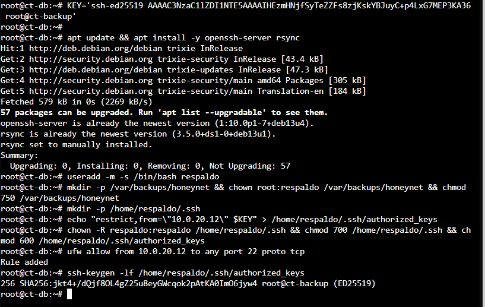<figcaption></figcaption></figure>

## **4.&#x20;**<mark style="color:$warning;">**Los scripts de copia**</mark>

**En `ct-db`**, `/usr/local/sbin/dump-honeynet.sh`:

```bash
#!/bin/bash
D=/var/backups/honeynet
mariadb-dump --single-transaction --routines --triggers --events honeypot_web | gzip > $D/honeypot_web-$(date +%F).sql.gz
chgrp respaldo $D/*.gz && chmod 640 $D/*.gz
find $D -name '*.gz' -mtime +7 -delete
```

`--single-transaction` hace el volcado sin bloquear la base de datos, y `--routines --triggers --events` incluye los procedimientos, triggers y eventos, que son la lógica del proyecto.

<figure>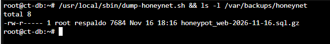<figcaption></figcaption></figure>

**En `ct-web`**, `/usr/local/sbin/backup-web.sh`:

```bash
#!/bin/bash
D=/var/backups/honeynet
tar czf $D/web-$(date +%F).tar.gz /var/www/honeynet.lan /etc/nginx/sites-available/honeynet.lan 2>/dev/null
chgrp respaldo $D/*.tar.gz && chmod 640 $D/*.tar.gz
find $D -name '*.tar.gz' -mtime +7 -delete
```

Cada uno se programa con `cron` en `/etc/cron.d/` (02:50 y 02:55) y se prueba una vez a mano. Resultado: `honeypot_web-AAAA-MM-DD.sql.gz` de unos 7,6 KB en `ct-db` y `web-AAAA-MM-DD.tar.gz` de unos 700 bytes en `ct-web`.

<figure>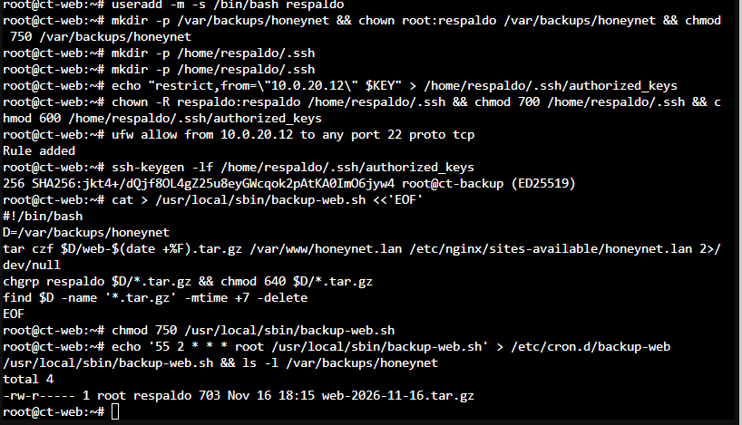<figcaption></figcaption></figure>

## **5.&#x20;**<mark style="color:$warning;">**Regla en pfSense**</mark>

`ct-db` está en la misma VLAN 20 que `ct-backup`, así que el tráfico no pasa por pfSense. `ct-web` está en la VLAN 60, así que hace falta una regla en la interfaz SERV:

| Campo       | Valor                   |
| ----------- | ----------------------- |
| Acción      | Pass, TCP               |
| Origen      | `10.0.20.12`            |
| Destino     | `10.0.60.10`, puerto 22 |
| Descripción | `backup a ct-web (SSH)` |

La regla es lo más estrecha posible: solo esa máquina, solo ese destino y solo ese puerto. Queda debajo de las demás y funciona igual, porque las reglas de arriba no coinciden con ese tráfico (una es el ping y el DNS a pfSense, otra bloquea solo hacia pfSense, y la de salida a internet solo deja pasar lo que no es red interna).

<figure>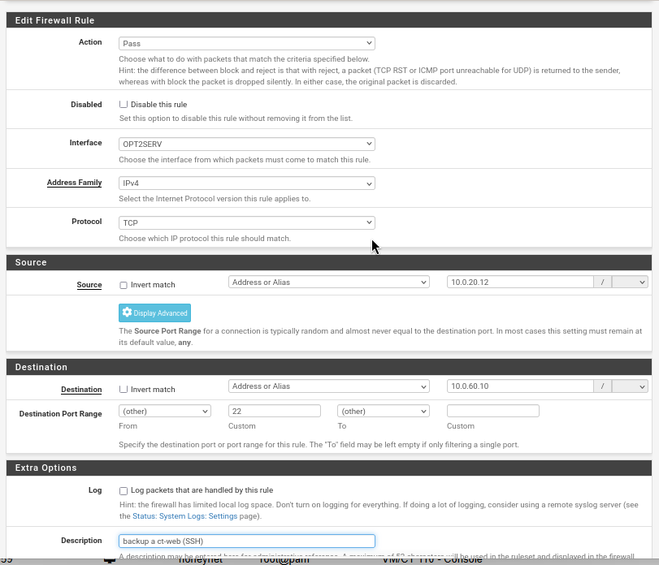<figcaption></figcaption></figure>

<figure>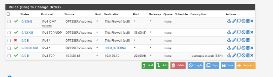<figcaption></figcaption></figure>

## **6.&#x20;**<mark style="color:$warning;">**Recoger las copias**</mark>

Primero, desde `ct-backup`, se hace una conexión de prueba a cada servidor para guardar su huella (`known_hosts`). No debe pedir contraseña:

```bash
ssh -i /root/.ssh/backup_key -o StrictHostKeyChecking=accept-new respaldo@10.0.20.11 true
ssh -i /root/.ssh/backup_key -o StrictHostKeyChecking=accept-new respaldo@10.0.60.10 true
```

<figure>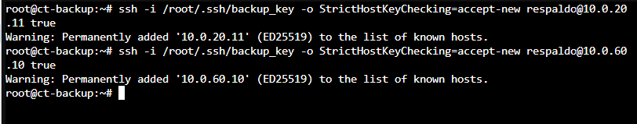<figcaption></figcaption></figure>

Después, el script `/usr/local/sbin/pull-backups.sh`:

```bash
#!/bin/bash
LOG=/var/log/backup.log
pull() {
  mkdir -p /srv/backups/$1
  if rsync -rt --chmod=D700,F600 -e "ssh -i /root/.ssh/backup_key" respaldo@$2:/var/backups/honeynet/ /srv/backups/$1/; then
    echo "$(date '+%F %T') OK $1" >> $LOG
  else
    echo "$(date '+%F %T') ERROR $1" >> $LOG
  fi
}
pull ct-db 10.0.20.11
pull ct-web 10.0.60.10
find /srv/backups -type f -mtime +30 -delete
```

`rsync -rt` copia solo lo que falta o ha cambiado, y `--chmod=D700,F600` deja los archivos legibles solo para `root` en `ct-backup`. Cada ejecución escribe `OK` o `ERROR` en `/var/log/backup.log`, y borra las copias de más de 30 días. Se programa a las 03:00 con `/etc/cron.d/pull-backups`.

## **7.&#x20;**<mark style="color:$warning;">**Pruebas**</mark>

```bash
ls -lR /srv/backups
tail /var/log/backup.log
zcat /srv/backups/ct-db/honeypot_web-*.sql.gz | grep -c "CREATE TABLE"
```

Resultado: aparecen los dos archivos con el mismo tamaño que en los servidores (7684 y 703 bytes), el log muestra `OK ct-db` y `OK ct-web`, y el volcado contiene las **11 tablas** de la base de datos.

<figure>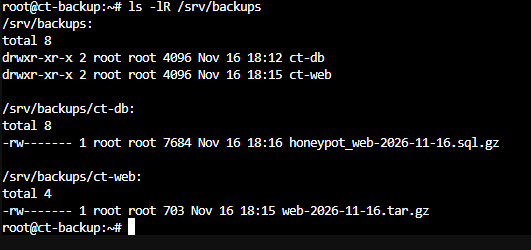<figcaption></figcaption></figure>

<figure>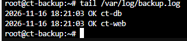<figcaption></figcaption></figure>

<figure>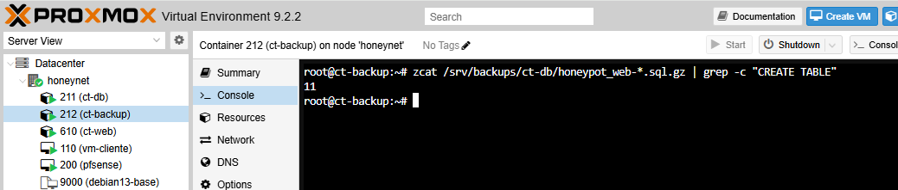<figcaption></figcaption></figure>

## **8.&#x20;**<mark style="color:$warning;">**Prueba de restauración**</mark>

**Concepto:** una copia que nunca se ha restaurado no se sabe si vale. Se restaura el volcado en una base de datos de prueba (`honeypot_web_test`), se comprueba el contenido y se borra, sin tocar la base real.

Primero se comprueba que la copia de `ct-backup` es idéntica a la original de `ct-db` comparando su huella `sha256`:

```bash
# En ct-backup
sha256sum $(ls -t /srv/backups/ct-db/*.sql.gz | head -1)
# En ct-db
F=$(ls -t /var/backups/honeynet/*.sql.gz | head -1)
sha256sum $F
```

Las dos huellas coinciden (`8734a326…`), así que la copia no se ha alterado en el traslado.


**CAPTURA PENDIENTE** — `12-huellas-sha256-iguales`: las dos salidas de `sha256sum` (ct-backup y ct-db).


Después se restaura en la base de prueba y se cuentan los objetos:

```bash
mariadb -e "CREATE DATABASE honeypot_web_test"
zcat $F | mariadb honeypot_web_test
mariadb -e "SELECT COUNT(*) AS tablas FROM information_schema.tables WHERE table_schema='honeypot_web_test'"
mariadb -e "SHOW TABLES FROM honeypot_web_test"
```

Salen **16 objetos**: las **11 tablas** más **5 vistas** (`vw_accesos_fallidos_recientes`, `vw_estadisticas_mensuales`, `vw_mensajes_admin`, `vw_planes_detalle` y `vw_usuarios_resumen`), porque `information_schema.tables` cuenta también las vistas. La importación termina sin errores.


**CAPTURA PENDIENTE** — `13-restauracion-16-objetos`: `CREATE DATABASE`, importación, recuento de 16 y listado de tablas y vistas.


Por último se borra la base de prueba:

```bash
mariadb -e "DROP DATABASE honeypot_web_test"
```

***

## <mark style="color:$warning;">**Problemas encontrados**</mark>

| Problema                                          | Causa                                                                 | Solución                                                                                         |
| ------------------------------------------------- | --------------------------------------------------------------------- | ------------------------------------------------------------------------------------------------ |
| Los comandos de un servidor se ejecutaron en otro | Se pegaron en la consola equivocada; el nombre del prompt lo delataba | Mirar siempre el prompt (`root@ct-db`, `root@ct-web`) antes de pegar y deshacer lo creado de más |
| `ufw: command not found` en `ct-backup`           | Ese contenedor no lleva cortafuegos propio                            | Es correcto: solo los servidores necesitan restringir el SSH                                     |
| Una copia de la web de 45 bytes                   | El script se ejecutó en `ct-db`, donde no existe `/var/www`           | Borrarla y ejecutar el script en `ct-web`                                                        |
