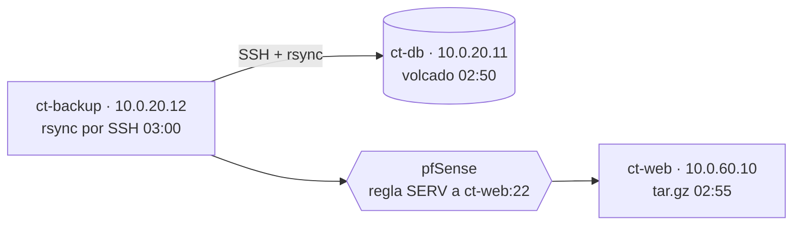

# Copias de seguridad con ct-backup

## Objetivo

Proteger los datos del proyecto ante pérdidas o ataques: una copia nocturna de la **base de datos** (`ct-db`) y de la **web** (`ct-web`), guardada en un contenedor aparte, `ct-backup`.



## Por qué modelo pull

En un modelo **push** cada servidor sube sus copias al servidor de copias, así que todos necesitan acceso a él. Si un atacante entra en uno, puede borrar también las copias. En el modelo **pull** es `ct-backup` quien entra a buscar los datos, y los servidores no tienen ninguna forma de entrar en él. Esto importa en un proyecto de honeypots, donde las máquinas expuestas pueden verse comprometidas.

## Qué se copia y cuándo

| Hora  | Máquina     | Qué hace                                                                 | Retención |
| ----- | ----------- | ------------------------------------------------------------------------ | --------- |
| 02:50 | `ct-db`     | Volcado de `honeypot_web` con tablas, procedimientos, triggers y eventos | 7 días    |
| 02:55 | `ct-web`    | `tar.gz` de `/var/www/honeynet.lan` y de la configuración de nginx       | 7 días    |
| 03:00 | `ct-backup` | Recoge las copias de los dos con `rsync` por SSH                         | 30 días   |

***

## 1. Crear el contenedor

Contenedor LXC sin privilegios, en la VLAN 20 junto a la base de datos.

| Ajuste        | Valor                                                                                 |
| ------------- | ------------------------------------------------------------------------------------- |
| ID y hostname | 212, `ct-backup`                                                                      |
| Plantilla     | `debian-13-standard_13.6-1_amd64.tar.zst`                                             |
| CPU y memoria | 1 núcleo, 256 MiB de RAM y 256 MiB de swap                                            |
| Disco         | 8 GiB en `local-lvm`                                                                  |
| Red           | `eth0`, bridge `vmbr1`, VLAN 20, `10.0.20.12/24`, gateway y DNS `10.0.20.1` (pfSense) |


CAPTURA 01 → `01-crear-ct-confirmacion.png`: la pantalla de confirmación del contenedor.


## 2. La clave SSH

**Concepto:** `ct-backup` se identifica ante los servidores con una clave en lugar de una contraseña, de modo que la copia nocturna funciona sin que nadie la escriba.

```bash
ssh-keygen -t ed25519 -f /root/.ssh/backup_key -N ""
```

La clave privada no sale de `ct-backup`; la pública (`backup_key.pub`) es la que se copia a los servidores.


CAPTURA 02 → `02-clave-ssh-generada.png`: la clave generada en `ct-backup`, con su huella y la clave pública.


## 3. Preparar `ct-db` y `ct-web`

En los dos servidores se crea un usuario `respaldo` sin privilegios, que solo puede leer la carpeta `/var/backups/honeynet`, y se instala la clave pública con dos restricciones:

* `restrict`: anula todo lo que no sea necesario (terminal, reenvíos, etc.).
* `from="10.0.20.12"`: solo se acepta la clave si la conexión viene de `ct-backup`.

```bash
KEY='ssh-ed25519 AAAA... root@ct-backup'
apt install -y openssh-server rsync
useradd -m -s /bin/bash respaldo
mkdir -p /var/backups/honeynet && chown root:respaldo /var/backups/honeynet && chmod 750 /var/backups/honeynet
mkdir -p /home/respaldo/.ssh
echo "restrict,from=\"10.0.20.12\" $KEY" > /home/respaldo/.ssh/authorized_keys
chown -R respaldo:respaldo /home/respaldo/.ssh && chmod 700 /home/respaldo/.ssh && chmod 600 /home/respaldo/.ssh/authorized_keys
ufw allow from 10.0.20.12 to any port 22 proto tcp
ssh-keygen -lf /home/respaldo/.ssh/authorized_keys
```

El último comando muestra la huella de la clave, que debe coincidir con la de `ct-backup`. El cortafuegos del servidor solo deja entrar por SSH a `10.0.20.12`.


CAPTURA 03 → `03-huella-ct-db.png`: la huella en `ct-db`. La huella de `ct-web` sale en la captura 05, junto a su copia.


## 4. Los scripts de copia

**En `ct-db`**, `/usr/local/sbin/dump-honeynet.sh`:

```bash
#!/bin/bash
D=/var/backups/honeynet
mariadb-dump --single-transaction --routines --triggers --events honeypot_web | gzip > $D/honeypot_web-$(date +%F).sql.gz
chgrp respaldo $D/*.gz && chmod 640 $D/*.gz
find $D -name '*.gz' -mtime +7 -delete
```

`--single-transaction` hace el volcado sin bloquear la base de datos, y `--routines --triggers --events` incluye los procedimientos, triggers y eventos, que son la lógica del proyecto.


CAPTURA 04 → `04-volcado-ct-db.png`: el volcado de `ct-db` con su tamaño.


**En `ct-web`**, `/usr/local/sbin/backup-web.sh`:

```bash
#!/bin/bash
D=/var/backups/honeynet
tar czf $D/web-$(date +%F).tar.gz /var/www/honeynet.lan /etc/nginx/sites-available/honeynet.lan 2>/dev/null
chgrp respaldo $D/*.tar.gz && chmod 640 $D/*.tar.gz
find $D -name '*.tar.gz' -mtime +7 -delete
```

Cada uno se programa con `cron` en `/etc/cron.d/` (02:50 y 02:55) y se prueba una vez a mano. Resultado: `honeypot_web-AAAA-MM-DD.sql.gz` de unos 7,6 KB en `ct-db` y `web-AAAA-MM-DD.tar.gz` de unos 700 bytes en `ct-web`.


CAPTURA 05 → `05-huella-y-copia-ct-web.png`: la huella en `ct-web`, el script y la copia creada.


## 5. Regla en pfSense

`ct-db` está en la misma VLAN 20 que `ct-backup`, así que el tráfico no pasa por pfSense. `ct-web` está en la VLAN 60, así que hace falta una regla en la interfaz SERV:

| Campo       | Valor                   |
| ----------- | ----------------------- |
| Acción      | Pass, TCP               |
| Origen      | `10.0.20.12`            |
| Destino     | `10.0.60.10`, puerto 22 |
| Descripción | `backup a ct-web (SSH)` |

La regla es lo más estrecha posible: solo esa máquina, solo ese destino y solo ese puerto. Queda debajo de las demás y funciona igual, porque las reglas de arriba no coinciden con ese tráfico (una es el ping y el DNS a pfSense, otra bloquea solo hacia pfSense, y la de salida a internet solo deja pasar lo que no es red interna).


CAPTURA 06 → `06-regla-pfsense-formulario.png`: el formulario de la regla.



CAPTURA 07 → `07-reglas-serv-lista.png`: la lista de reglas de SERV con la nueva regla al final.


## 6. Recoger las copias

Primero, desde `ct-backup`, se hace una conexión de prueba a cada servidor para guardar su huella (`known_hosts`). No debe pedir contraseña:

```bash
ssh -i /root/.ssh/backup_key -o StrictHostKeyChecking=accept-new respaldo@10.0.20.11 true
ssh -i /root/.ssh/backup_key -o StrictHostKeyChecking=accept-new respaldo@10.0.60.10 true
```


CAPTURA 08 → `08-ssh-prueba-sin-contrasena.png`: las dos conexiones de prueba, sin contraseña y sin error.


Después, el script `/usr/local/sbin/pull-backups.sh`:

```bash
#!/bin/bash
LOG=/var/log/backup.log
pull() {
  mkdir -p /srv/backups/$1
  if rsync -rt --chmod=D700,F600 -e "ssh -i /root/.ssh/backup_key" respaldo@$2:/var/backups/honeynet/ /srv/backups/$1/; then
    echo "$(date '+%F %T') OK $1" >> $LOG
  else
    echo "$(date '+%F %T') ERROR $1" >> $LOG
  fi
}
pull ct-db 10.0.20.11
pull ct-web 10.0.60.10
find /srv/backups -type f -mtime +30 -delete
```

`rsync -rt` copia solo lo que falta o ha cambiado, y `--chmod=D700,F600` deja los archivos legibles solo para `root` en `ct-backup`. Cada ejecución escribe `OK` o `ERROR` en `/var/log/backup.log`, y borra las copias de más de 30 días. Se programa a las 03:00 con `/etc/cron.d/pull-backups`.

## 7. Pruebas

```bash
ls -lR /srv/backups
tail /var/log/backup.log
zcat /srv/backups/ct-db/honeypot_web-*.sql.gz | grep -c "CREATE TABLE"
```

Resultado: aparecen los dos archivos con el mismo tamaño que en los servidores (7684 y 703 bytes), el log muestra `OK ct-db` y `OK ct-web`, y el volcado contiene las **11 tablas** de la base de datos.


CAPTURA 09 → `09-ls-srv-backups.png`: `ls -lR /srv/backups` con las dos copias.



CAPTURA 10 → `10-log-backup-ok.png`: el log con `OK ct-db` y `OK ct-web`.



CAPTURA 11 → `11-recuento-11-tablas.png`: el recuento de 11 tablas en el volcado.


***

## Problemas encontrados

| Problema                                          | Causa                                                                 | Solución                                                                                         |
| ------------------------------------------------- | --------------------------------------------------------------------- | ------------------------------------------------------------------------------------------------ |
| Los comandos de un servidor se ejecutaron en otro | Se pegaron en la consola equivocada; el nombre del prompt lo delataba | Mirar siempre el prompt (`root@ct-db`, `root@ct-web`) antes de pegar y deshacer lo creado de más |
| `ufw: command not found` en `ct-backup`           | Ese contenedor no lleva cortafuegos propio                            | Es correcto: solo los servidores necesitan restringir el SSH                                     |
| Una copia de la web de 45 bytes                   | El script se ejecutó en `ct-db`, donde no existe `/var/www`           | Borrarla y ejecutar el script en `ct-web`                                                        |

## Pendiente

* Snapshot `backup-ok` del contenedor `ct-backup`.
* Prueba de restauración de la base de datos en una base de datos de pruebas.
* Copia de `ct-backup` fuera del PC (ver [Copias de seguridad y snapshots](../1.-plantillas-y-configuracion-basica/copias-de-seguridad-y-snapshots.md)).
