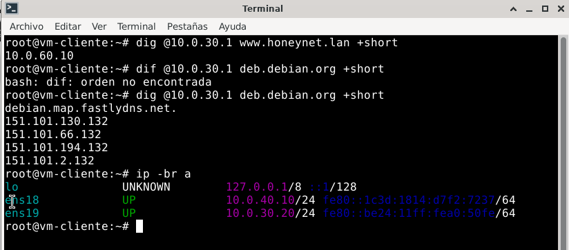
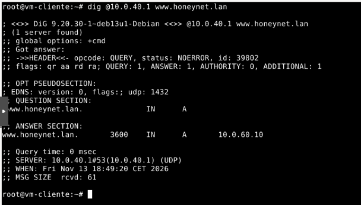

# DHCP por MAC y DNS

El servidor DHCP de pfSense reparte las IPs de la VLAN 40 del `.100` al `.200` y asigna una IP fija a cada equipo conocido según su dirección MAC. Los servidores llevan IP fija configurada en Proxmox, para que sigan funcionando si el DHCP falla.

El DNS Resolver de pfSense reenvía las consultas al DNS del centro y resuelve los nombres del laboratorio (`honeynet.lan`) con _host overrides_: `ct-web`, `www`, `ct-db` y `ct-backup`.

## <mark style="color:$warning;">**Prueba desde la VM cliente**</mark>

La VM cliente recibe `10.0.40.10`, la IP asignada a su MAC, y el DNS de pfSense resuelve `www.honeynet.lan` a `10.0.60.10`, con una respuesta autoritativa.

<figure><figcaption></figcaption></figure>

<figure><figcaption></figcaption></figure>
