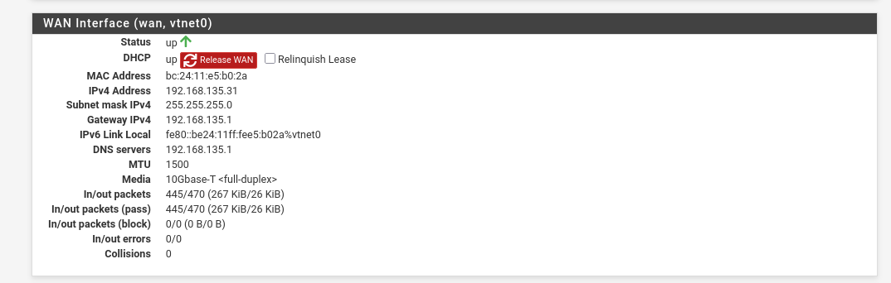

# pfSense: interfaces y reglas

La WAN va por `vmbr0` y recibe su IP por DHCP del centro. Las seis VLANs internas llegan por una única tarjeta virtual, que no lleva etiqueta de VLAN, y pfSense crea una interfaz por cada una.

<figure><figcaption></figcaption></figure>

## Interfaces

| Interfaz | Descripción     | IP             |
| -------- | --------------- | -------------- |
| WAN      | Red del centro  | Por DHCP       |
| LAN      | MGMT (VLAN 30)  | `10.0.30.1/24` |
| OPT1     | DMZ (VLAN 10)   | `10.0.10.1/24` |
| OPT2     | SERV (VLAN 20)  | `10.0.20.1/24` |
| OPT3     | USERS (VLAN 40) | `10.0.40.1/24` |
| OPT4     | ATK (VLAN 50)   | `10.0.50.1/24` |
| OPT5     | WEB (VLAN 60)   | `10.0.60.1/24` |

## Reglas del firewall

pfSense bloquea por defecto todo lo que no esté permitido, y las reglas se evalúan de arriba abajo. En cada VLAN se permite el ping a la puerta de enlace y el DNS de pfSense, se bloquea el acceso a la administración de pfSense y se permite la salida a internet (todo lo que no sea la red interna, con el alias `RED_INTERNA` invertido). La VLAN 40 puede abrir la web y la VLAN 60 puede consultar la base de datos. La WAN, la DMZ y la VLAN del atacante no llevan reglas, así que lo bloquean todo.

| VLAN       | Reglas, de arriba abajo                                                                                        |
| ---------- | -------------------------------------------------------------------------------------------------------------- |
| SERV (20)  | Ping a pfSense, DNS a pfSense, bloqueo a pfSense, salida a internet, y SSH de `ct-backup` a `ct-web`           |
| USERS (40) | Ping a pfSense, DNS a pfSense, web (puertos 80 y 443) hacia `10.0.60.10`, bloqueo a pfSense, salida a internet |
| WEB (60)   | Ping a pfSense, DNS a pfSense, base de datos (3306) hacia `10.0.20.11`, bloqueo a pfSense, salida a internet   |

<figure><figcaption></figcaption></figure>

<figure><figcaption></figcaption></figure>

<figure><figcaption></figcaption></figure>
