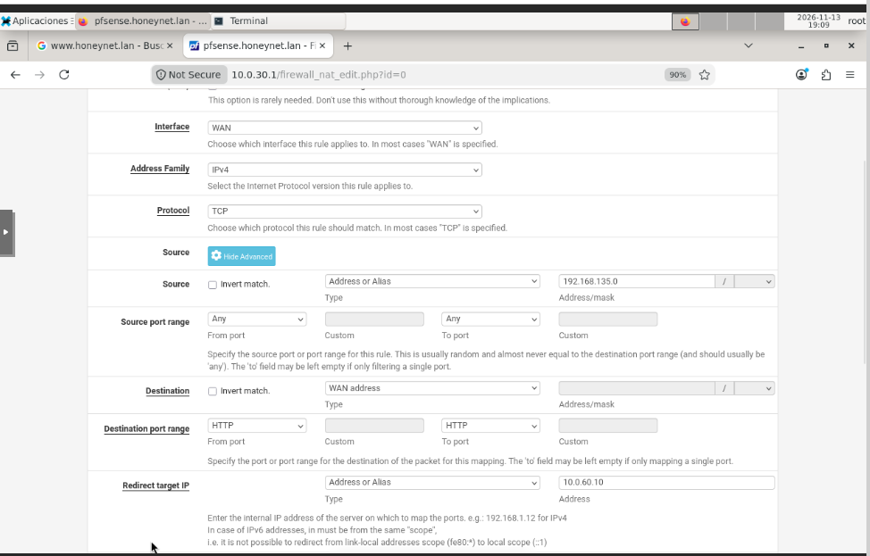
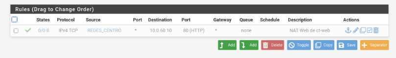

# Reenvío de puertos (NAT)

La web se publica por la WAN de pfSense con una regla de NAT (puerto 80 de la WAN hacia `10.0.60.10`) y su regla asociada en la WAN, limitada a las redes del centro con un alias.

<figure><figcaption></figcaption></figure>

<figure><figcaption></figcaption></figure>

## <mark style="color:$warning;">**Prueba desde otro PC del centro**</mark>

```
PS> Test-NetConnection 192.168.135.31 -Port 80
TcpTestSucceeded : True
```
