# Suricata (IDS)

## <mark style="color:$warning;">**Objetivo**</mark>

Suricata es un **detector de intrusiones (IDS)**: mira el tráfico que pasa por una interfaz de pfSense, lo compara con miles de reglas de ataques conocidos y **avisa** cuando algo coincide. Se deja en modo solo avisar (sin bloquear), porque un falso positivo que corte tráfico en pleno montaje complica el trabajo. Los avisos los recogerá Wazuh en la Fase 5.

En esta fase Suricata escucha solo en la **VLAN Web** (`OPT5WEB`). La DMZ se añadirá en la Fase 4, cuando exista la VM de honeypots, que es donde de verdad interesa.

## **1.&#x20;**<mark style="color:$warning;">**Presupuesto de memoria**</mark>

El PC 1 tiene 8 GB de RAM y el centro no permite ampliarla, así que antes de instalar nada se comprobó si cabía. El nodo iba al **83 %** de memoria (6,29 de 7,59 GiB) y con 753 MiB en swap.

<figure>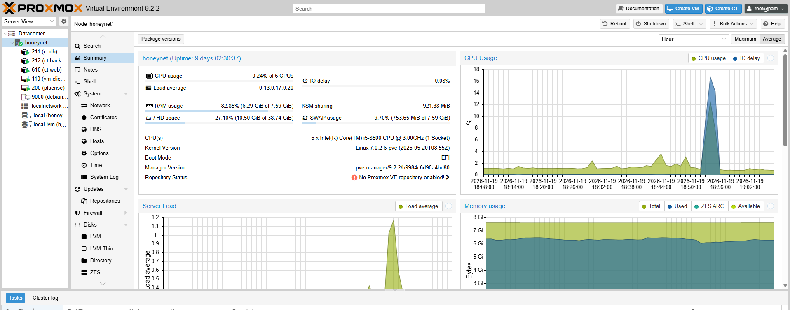<figcaption></figcaption></figure>

Se miró qué reserva cada máquina con el Shell del nodo:

```bash
qm list
for c in 211 212 610; do echo -n "CT $c: "; pct config $c | grep -E "^memory"; done
free -h
```

<table><thead><tr><th width="220">Máquina</th><th>RAM asignada</th></tr></thead><tbody><tr><td>pfSense (200)</td><td><strong>4096 MB</strong></td></tr><tr><td>vm-cliente (110)</td><td>1536 MB</td></tr><tr><td><code>ct-db</code>, <code>ct-backup</code>, <code>ct-web</code></td><td>256 MB cada una</td></tr></tbody></table>

<figure>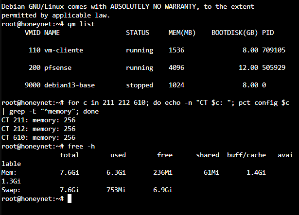<figcaption></figcaption></figure>


El dashboard de pfSense (_Status → Dashboard → System Information_) mostraba que usaba solo el **7 % de sus 4 GB** (unos 280 MB):

<figure>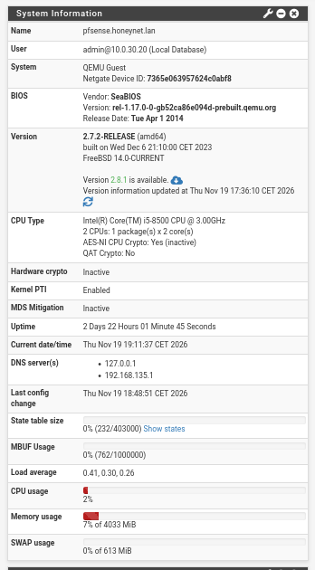<figcaption></figcaption></figure>


Se bajó pfSense a **2048 MB**, lo que libera unos 2 GB para la VM de honeypots y deja sitio de sobra para Suricata. \
Los pasos fueron: _Diagnostics → Halt System_ en pfSense, en Proxmox VM 200 → Hardware → Memory → `2048`, y _Start_. La memoria solo se aplica al apagar y encender la VM, y las VLANs se quedan sin red un par de minutos.

Tras arrancar se comprobó desde `vm-cliente` que todo seguía funcionando:

```bash
ping -c2 10.0.40.1
curl -skS -m5 -o /dev/null -w "web: %{http_code}\n" https://www.honeynet.lan
ping -c2 1.1.1.1
```

<figure>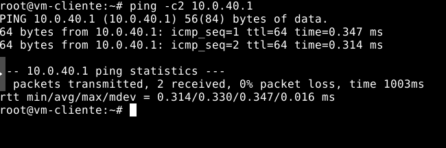<figcaption></figcaption></figure>

<figure>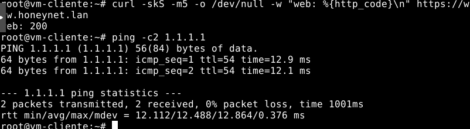<figcaption></figcaption></figure>

## **2.&#x20;**<mark style="color:$warning;">**Instalar el paquete**</mark>

En pfSense: _System → Package Manager → Available Packages_, se busca `suricata` (versión 7.0.8\_1) y se pulsa **Install** y **Confirm**. Hay que esperar a que ponga **Success**. El aviso final sobre `net.bpf.zerocopy_enable` es una optimización opcional y se ignora.

<figure>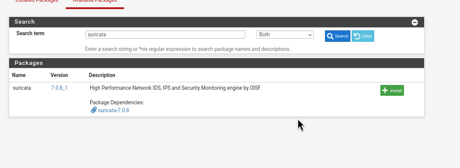<figcaption></figcaption></figure>

<figure>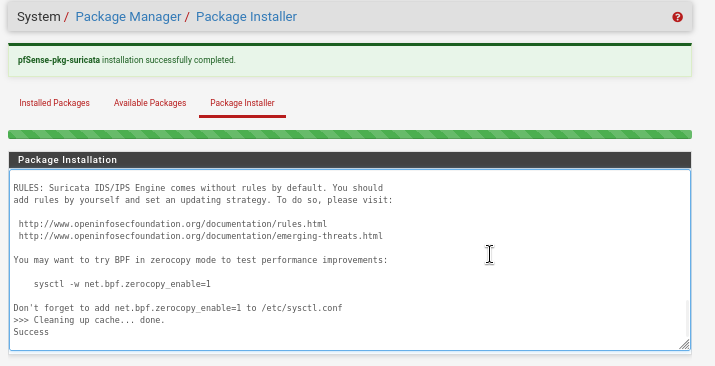<figcaption></figcaption></figure>


## **3.&#x20;**<mark style="color:$warning;">**Ajustes globales y reglas**</mark>

En _Services → Suricata → Global Settings_:

* **Install ETOpen Emerging Threats rules**: marcado (reglas gratuitas). ETPro, Snort, Feodo y ABUSE.ch quedan sin marcar porque son de pago, necesitan cuenta o no hacen falta.
* **Hide Deprecated Rules Categories**: marcado.
* **Update Interval**: `12 HOURS`.

Después, en la pestaña **Updates**, el botón **Update** descarga las reglas. Resultado: `success`, con la firma MD5 de _Emerging Threats Open Rules_ y la fecha de hoy. La descarga sale por la WAN de pfSense, así que no la afectan las reglas de las VLANs.

<figure><figcaption></figcaption></figure>

<figure>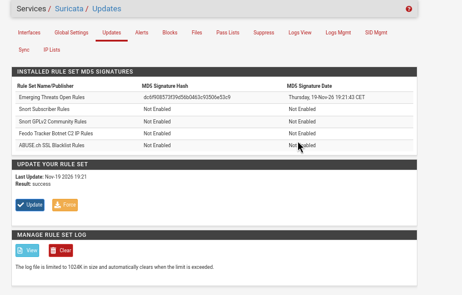<figcaption></figcaption></figure>

## **4.&#x20;**<mark style="color:$warning;">**La interfaz Web**</mark>

**Concepto:** Suricata se asocia a una interfaz de pfSense. Se empieza por **WEB (`OPT5WEB`, `vtnet1.60`)**, que es la que tiene tráfico real y está publicada hacia fuera por el reenvío de puertos.

En _Services → Suricata → Interfaces → Add_:

<table><thead><tr><th width="260">Ajuste</th><th>Valor</th></tr></thead><tbody><tr><td>Enable</td><td>Marcado</td></tr><tr><td>Interface</td><td><code>OPT5WEB (vtnet1.60)</code></td></tr><tr><td>Description</td><td><code>WEB</code></td></tr><tr><td>Send Alerts to System Log</td><td>Marcado</td></tr><tr><td>Block Offenders</td><td><strong>Sin marcar</strong> (modo IDS)</td></tr><tr><td>EVE JSON Log</td><td>Sin marcar (se activará en la Fase 5 para Wazuh)</td></tr></tbody></table>

<figure>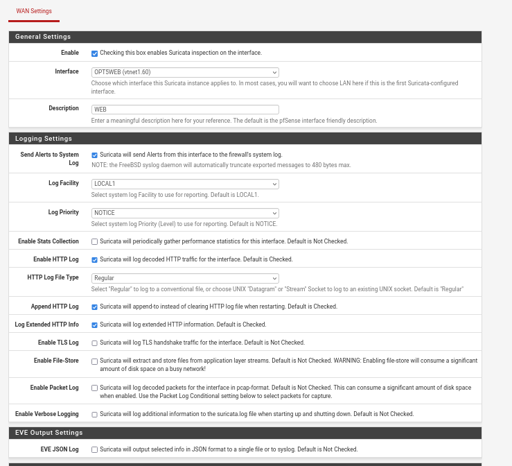<figcaption></figcaption></figure>


Tras guardar, la lista de interfaces muestra WEB parada y con `Blocking Mode: DISABLED`:

<figure>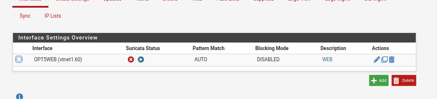<figcaption></figcaption></figure>

## **5.&#x20;**<mark style="color:$warning;">**Qué reglas aplicar**</mark>

ET Open trae miles de reglas en categorías. Cargarlas todas gasta más de 1 GB de RAM y la mayoría no tiene sentido para una web, así que se eligen solo las relevantes. En la pestaña **WEB Categories** se marcan estas 8:

* `emerging-scan`
* `emerging-web_server`
* `emerging-web_specific_apps`
* `emerging-sql`
* `emerging-exploit`
* `emerging-dos`
* `emerging-shellcode`
* `emerging-attack_response`

Las reglas de la columna izquierda (`app-layer-events`, `http-events`, `tls-events`...) son del propio Suricata y avisan de anomalías de protocolo. Son muy ligeras y se dejan como vienen.

<figure>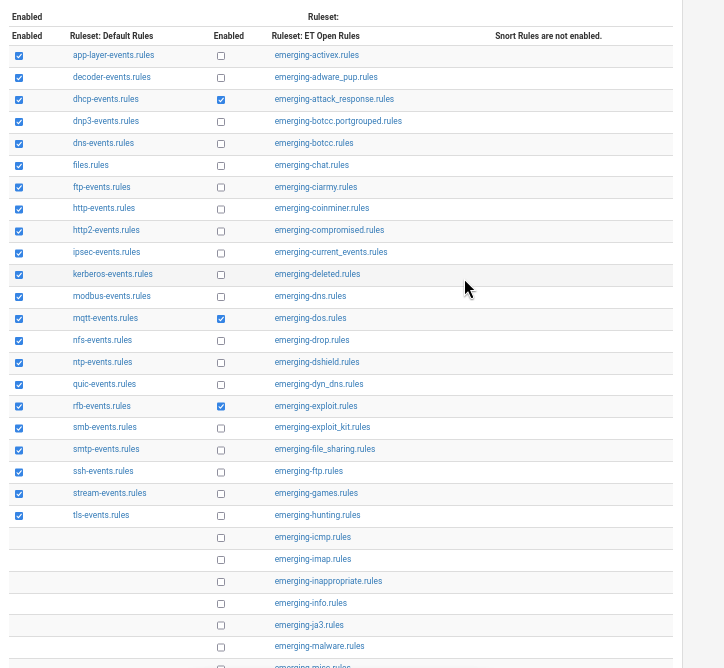<figcaption></figcaption></figure>

<figure>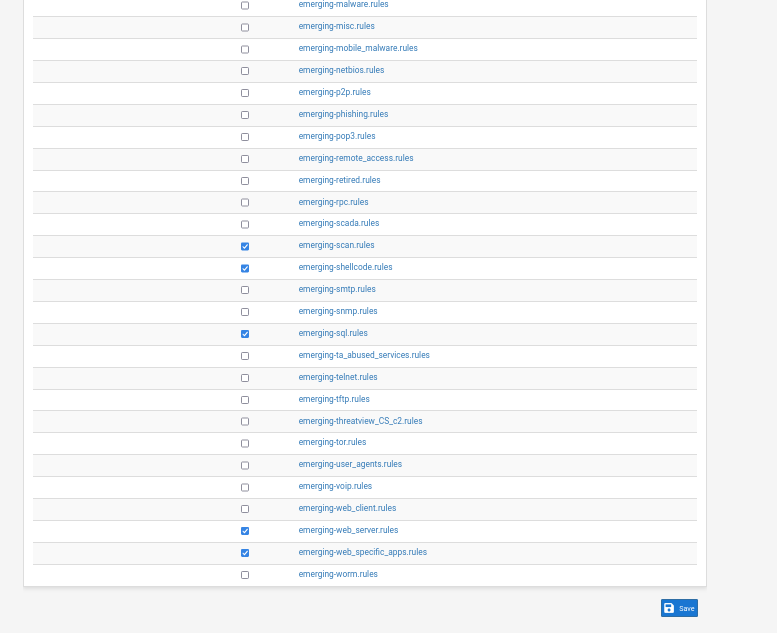<figcaption></figcaption></figure>


Después se arranca la interfaz con el botón ▶ de la lista y pasa a una marca verde:

<figure>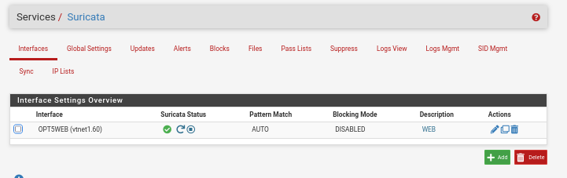<figcaption></figcaption></figure>


## **6.&#x20;**<mark style="color:$warning;">**Pruebas**</mark>

**Peticiones de prueba.** Desde `vm-cliente`, por HTTP (puerto 80, que Suricata puede leer), con un user-agent de herramienta de auditoría:

```bash
curl -s -m5 -o /dev/null -w "%{http_code}\n" -A "sqlmap/1.7" "http://10.0.60.10/?id=1"
```

La respuesta es `301` (la redirección a HTTPS), lo que confirma que la petición llega a `ct-web`.

<figure>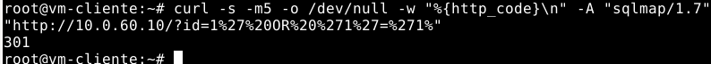<figcaption></figcaption></figure>

**¿Lo ve Suricata?** En _Services → Suricata → Logs View_, con la instancia `(OPT5WEB) WEB`:

* `http.log` muestra las peticiones de `10.0.40.10` hacia `10.0.60.10` con ese user-agent. La captura funciona.
* `suricata.log` indica `10219 rules successfully loaded, 0 rules failed` y `Engine started`.

<figure>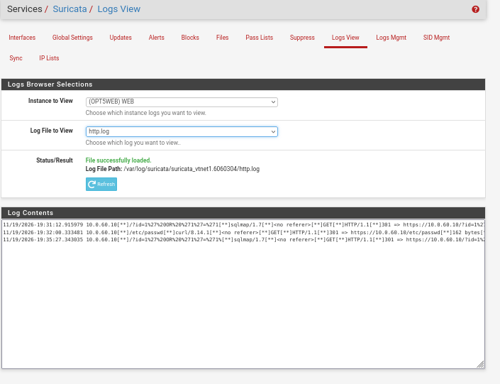<figcaption></figcaption></figure>

<figure>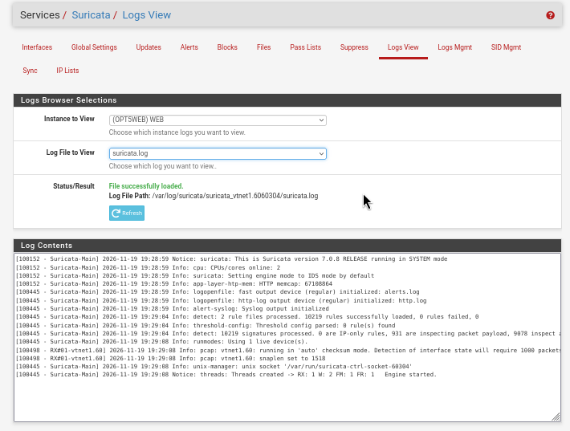<figcaption></figcaption></figure>


**Primer intento sin aviso.** `alerts.log` salió vacío: las peticiones se ven, pero ninguna de las 8 categorías tiene una regla que coincida con ellas (cada regla de ET busca patrones muy concretos).

<figure>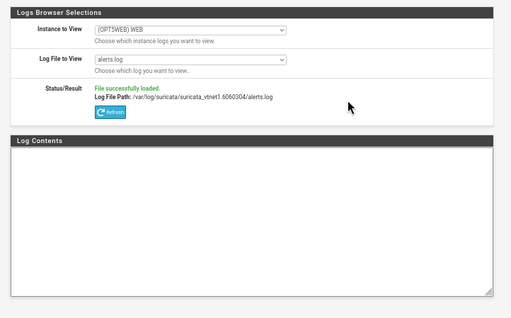<figcaption></figcaption></figure>


**Regla propia de prueba.** Para comprobar que toda la cadena funciona, se añade una regla que solo dispara con ese user-agent. En la pestaña **WEB Rules**, en el desplegable _Category_ se elige `custom.rules` y se pega, en una sola línea:

```
alert http any any -> any any (msg:"HONEYNET TEST user-agent"; http.user_agent; content:"sqlmap"; nocase; sid:9000001; rev:1;)
```

Se pulsa **Save** y se reinicia la interfaz con las flechas circulares. Después se repite la petición y en `alerts.log` aparece el aviso:

```
[1:9000001:1] HONEYNET TEST user-agent ... {TCP} 10.0.40.10:... -> 10.0.60.10:80
```

<figure>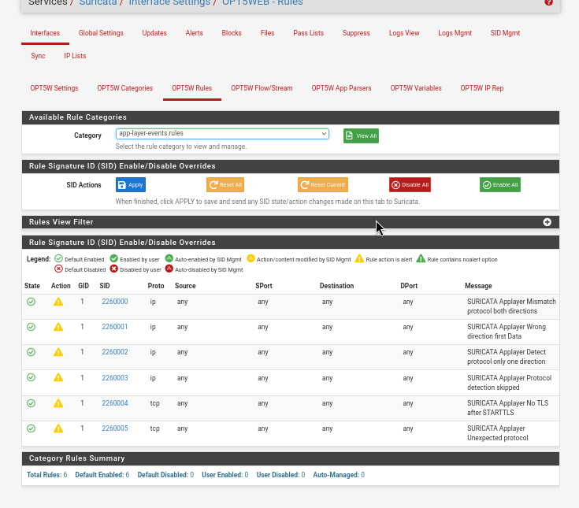<figcaption></figcaption></figure>

<figure>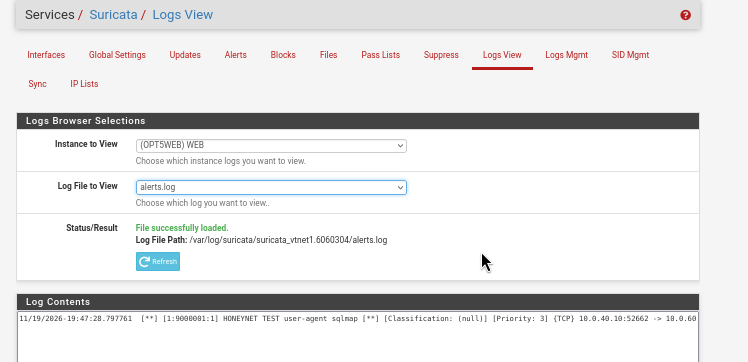<figcaption></figcaption></figure>


## **7.&#x20;**<mark style="color:$warning;">**Consumo de memoria**</mark>

Con Suricata y las 8 categorías, pfSense usa el **28 % de sus 1985 MiB** (unos 556 MB), frente a los 280 MB de antes: Suricata cuesta unos 280 MB. Sobra margen para añadir la DMZ más adelante.

<figure>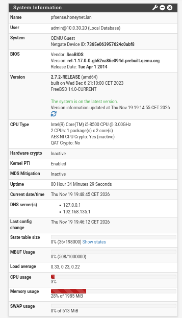<figcaption></figcaption></figure>


## <mark style="color:$warning;">**Limitaciones y siguientes pasos**</mark>

* **HTTPS:** la web se sirve por HTTPS y Suricata no descifra el tráfico, así que solo ve escaneos de puertos y las peticiones por HTTP (puerto 80) antes de la redirección, no los ataques dentro de una conexión HTTPS. Los ataques que interesan llegarán a los honeypots de la DMZ, donde sí se podrá inspeccionar.
* **DMZ:** se añadirá como segunda interfaz en la Fase 4, cuando exista la VM de honeypots.
* **Wazuh:** en la Fase 5 se activará el EVE JSON Log para enviar los avisos al SIEM.
