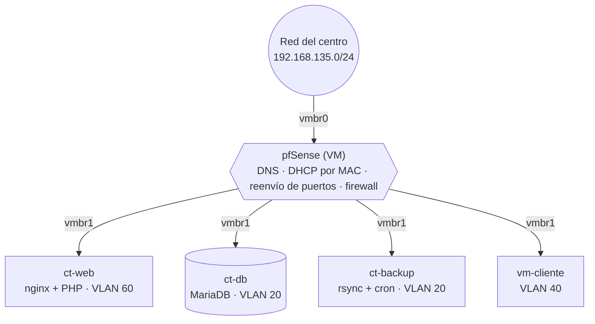

# Red real del proyecto

## Objetivo

Montar la red que se dibujó en la pizarra y que será la red del proyecto: la red del centro entra por `vmbr0` a **pfSense**, que hace el reenvío de puertos, las VLANs y el DHCP por MAC, y por `vmbr1` cuelgan los servicios (NGINX, base de datos y copias). El **DNS lo hace el propio pfSense**, así que no hace falta un contenedor para él.

<figure><figcaption></figcaption></figure>

## Estado

| Elemento                                       | Resultado                        |
| ---------------------------------------------- | -------------------------------- |
| Red del centro → `vmbr0` → pfSense             | Hecho: la WAN recibe IP por DHCP |
| VLANs 10, 20, 30, 40, 50 y 60 sobre `vmbr1`    | Hecho                            |
| Reglas del firewall por VLAN                   | Hecho                            |
| DHCP por MAC (VLAN 40) y DNS en pfSense        | Hecho                            |
| `ct-web` (NGINX y PHP-FPM) y `ct-db` (MariaDB) | Hecho                            |
| Reenvío de puertos hacia NGINX                 | Hecho                            |
| `ct-backup`                                    | Hecho                            |

## Cómo se organiza esta parte

Cada pieza tiene su página, en el orden en que se montó:

1. [pfSense: interfaces y reglas](pfsense-interfaces-y-reglas.md): las VLANs y el firewall de cada red.
2. [DHCP por MAC y DNS](dhcp-por-mac-y-dns.md): direcciones fijas por MAC y resolución de `honeynet.lan`.
3. [Reenvío de puertos (NAT)](reenvio-de-puertos-nat.md): cómo se publica la web por la WAN.
4. [Contenedores ct-db y ct-web](contenedores-ct-db-y-ct-web.md): los servidores de la base de datos y de la web.
5. [Base de datos](base-de-datos.md): MariaDB y el script de la base de datos.
6. [Prueba de punta a punta y problemas](prueba-de-punta-a-punta-y-problemas.md): la web completa desde la VM cliente y lo que falló por el camino.
7. [Copias de seguridad con ct-backup](copias-de-seguridad-con-ct-backup.md): copias nocturnas de la base de datos y de la web.
