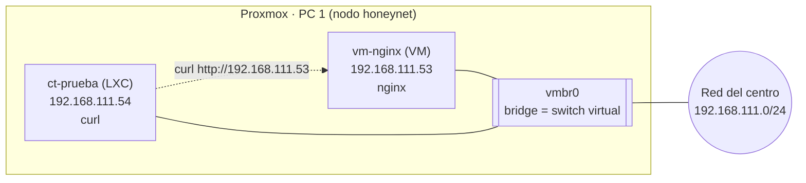

# Práctica: VM con nginx y contenedor LXC

## Objetivo

Montar en Proxmox una **VM con nginx** (clonada de la plantilla) y un **contenedor LXC**, conectados entre sí, para demostrar cómo funcionan, en qué se diferencian y cómo se comunican.

## Qué se monta



## Conceptos clave

|             | VM                  | Contenedor LXC |
| ----------- | ------------------- | -------------- |
| Kernel      | El suyo propio      | El de Proxmox  |
| Memoria     | Más                 | Muy poca       |
| Arranque    | Decenas de segundos | Segundos       |
| Herramienta | `qm`                | `pct`          |

Las dos máquinas se conectan al mismo **bridge** (`vmbr0`), que actúa como un switch virtual: por eso el contenedor puede hablar con la VM.

Requisitos: la plantilla `debian13-base` ([Plantilla de VM Debian 13](plantilla-de-vm-debian-13.md)) y la plantilla de contenedor `debian-13` ([Clones y contenedor LXC](clones-y-contenedor-lxc.md)).

***

## Parte 1. VM con nginx

### 1.1 Clonar la plantilla

Clic derecho sobre `debian13-base` → **Clone** → _Full Clone_, nombre `vm-nginx`. Después, en **Hardware → Memory**, 512 MiB, y **Start**.


CAPTURA PENDIENTE: el asistente de clonado y la VM `vm-nginx` en el árbol.


### 1.2 Darle identidad propia

En la consola de la VM, como `root`:

```bash
ssh-keygen -A
systemctl restart ssh
hostnamectl set-hostname vm-nginx
ip -br a
```

La interfaz `ens18` recibió la IP **192.168.111.53/24**.


CAPTURA PENDIENTE: la consola con los comandos y la salida de `ip -br a`.


### 1.3 Instalar nginx y publicar una página

```bash
apt update && apt install nginx -y
echo "<h1>hola desde la VM con nginx</h1>" > /var/www/html/index.html
systemctl status nginx --no-pager
curl localhost
```

El resultado es `<h1>hola desde la VM con nginx</h1>`: nginx sirve la página en local.


CAPTURA PENDIENTE: `curl localhost` mostrando el mensaje.


***

## Parte 2. Contenedor LXC

### 2.1 Crearlo

Con **Create CT** y estos valores:

| Ajuste          | Valor                                      |
| --------------- | ------------------------------------------ |
| ID y hostname   | 101, `ct-prueba`                           |
| Plantilla       | `debian-13-standard_13.6-1_amd64.tar.zst`  |
| Sin privilegios | Sí                                         |
| CPU y memoria   | 1 núcleo, 256 MiB de RAM y 256 MiB de swap |
| Disco           | 2 GiB en `local-lvm`                       |
| Red             | `eth0`, bridge `vmbr0`, IP por DHCP        |

La tarea de creación termina con el aviso _«Systemd 257 detected. You may need to enable nesting»_, que no impide que el contenedor funcione.


CAPTURA PENDIENTE: la pantalla de confirmación del contenedor y el resultado de la tarea de creación.


### 2.2 Arrancarlo y comprobar la red

En la consola del contenedor:

```bash
ip -br a
ip route
```

`eth0` recibió la IP **192.168.111.54/24** y hay una ruta por defecto por `192.168.111.1`.


CAPTURA PENDIENTE: `ip -br a` y `ip route` en el contenedor.


***

## Parte 3. Conectar el contenedor con la VM

```bash
apt update && apt install curl -y
curl http://192.168.111.53
```

El contenedor recibe el mensaje de la página de la VM: queda demostrado que están conectados a través del bridge.


CAPTURA PENDIENTE: `curl` desde el contenedor mostrando el mensaje de la VM.


***

## Parte 4. Comparar la VM y el contenedor

### 4.1 Kernel

```bash
uname -r
```

En la VM sale el kernel de Debian (`6.12.113+deb13-amd64`). En el contenedor sale el kernel de Proxmox, que lleva `pve` en el nombre: el contenedor comparte kernel con el host.


CAPTURA PENDIENTE: `uname -r` en la VM y en el contenedor.


### 4.2 El bridge

En la Shell del nodo (**honeynet → Shell**):

```bash
qm list
pct list
bridge link | grep vmbr0
```

`qm list` muestra las VMs y `pct list` los contenedores. `bridge link` muestra las interfaces conectadas al bridge: una `tap` por cada VM y una `veth` por cada contenedor.


CAPTURA PENDIENTE: la salida de los tres comandos.


### 4.3 Memoria

En **honeynet → Summary** se compara lo que gastan: 512 MiB asignados a la VM frente a 256 MiB al contenedor.


CAPTURA PENDIENTE: el uso de memoria de las dos máquinas.


***

## Problema encontrado y solución

| Fase        | Qué pasó                                                                                                                                  |
| ----------- | ----------------------------------------------------------------------------------------------------------------------------------------- |
| Síntoma     | `apt update` en el contenedor fallaba con «Temporary failure resolving deb.debian.org»                                                    |
| Diagnóstico | `ip -br a` solo mostraba una dirección interna `fe80`, `ip route` estaba vacío y `ping` daba «Network is unreachable». El DNS estaba bien |
| Causa       | Se cambió el nombre de la interfaz de red (de `Bridge` a `eth0`) con el contenedor encendido, y Proxmox aplica la red al arrancar         |
| Solución    | Apagarlo del todo con **Shutdown** y volver a arrancarlo: obtuvo la IP 192.168.111.54                                                     |
| Lección     | Los cambios de red de un contenedor LXC se aplican al arrancar, no en caliente                                                            |


CAPTURA PENDIENTE: el error de `apt`, `ip -br a` sin IP y `ip -br a` ya con IP.


***

## Conclusiones

* Una **VM** lleva su propio sistema y kernel; un **contenedor** comparte el del host, por eso arranca antes y gasta menos memoria.
* Las dos pueden estar en la misma red gracias al **bridge** de Proxmox.
* Esta práctica es una versión pequeña de lo que se usará en el laboratorio: servidores en contenedores y máquinas virtuales clonadas de una plantilla.
