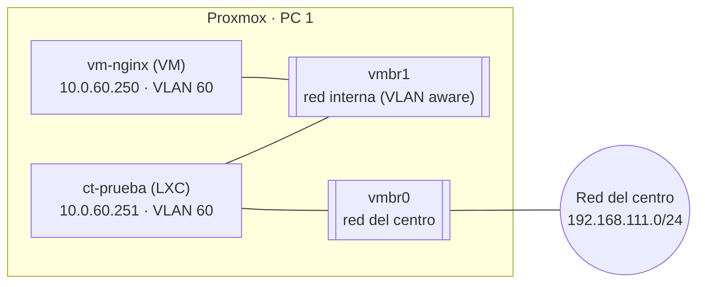

# Red interna con VLAN (vmbr1)

## Objetivo

Crear dentro de Proxmox una **red interna aislada**, sin salida a la red del centro, y conectar a ella una VM y un contenedor en la **VLAN 60** (la de la web). Sirve para practicar las VLANs del proyecto sin tocar la red real.

## Conceptos

* **`vmbr0`** es el bridge principal: está unido a la tarjeta física, tiene la IP de gestión del nodo y da salida a la red del centro. **No se modifica**, porque un error cortaría el acceso a Proxmox.
* **`vmbr1`** es un bridge **sin tarjeta física**: un switch virtual cerrado. Las máquinas conectadas a él solo se ven entre sí.
* Se crea **compatible con VLANs** (_VLAN aware_), de modo que la separación se hace poniendo una **etiqueta** en la tarjeta de cada máquina.
* Dos máquinas en la misma VLAN se ven; en VLANs distintas no, mientras no haya un router entre ellas (será pfSense, en la Fase 2).



***

## 1. Crear el bridge `vmbr1`

En **honeynet → System → Network → Create → Linux Bridge**:

| Campo               | Valor         | Por qué                            |
| ------------------- | ------------- | ---------------------------------- |
| Name                | `vmbr1`       | El siguiente nombre libre          |
| IPv4/CIDR y Gateway | Vacíos        | El nodo no necesita IP en esta red |
| Autostart           | Marcado       | Que exista al arrancar             |
| VLAN aware          | Marcado       | Para poder etiquetar VLANs         |
| Bridge ports        | Vacío         | Sin tarjeta física: red cerrada    |
| Comment             | `Red interna` | Para reconocerlo                   |

Después se pulsa **Apply Configuration**. Como no toca `vmbr0`, no se pierde el acceso.

Comprobación en la Shell del nodo: `ip -br link show vmbr1` muestra el bridge, y en _System → Network_ pone _Active: Yes_ y _VLAN aware: Yes_.


CAPTURA PENDIENTE: _System → Network_ con `vmbr1` creado.


## 2. Conectar la VM a la VLAN 60

En **vm-nginx → Hardware → Add → Network Device**:

| Campo    | Valor      |
| -------- | ---------- |
| Bridge   | `vmbr1`    |
| VLAN Tag | `60`       |
| Model    | VirtIO     |
| Firewall | Desmarcado |

Dentro de la VM, la interfaz nueva aparece como `ens19`. Se le asigna una IP fija en el archivo de configuración de red de Debian, añadiendo al final:

```
auto ens19
iface ens19 inet static
    address 10.0.60.250/24
```

Y se activa con `ifup ens19`. La IP se mantiene tras reiniciar.


CAPTURA PENDIENTE: la tarjeta de red nueva en _Hardware_ y el `ip -br a` de la VM.


## 3. Conectar el contenedor a la VLAN 60

En **ct-prueba → Network → Add**:

| Campo    | Valor                    |
| -------- | ------------------------ |
| Name     | `eth1`                   |
| Bridge   | `vmbr1`                  |
| VLAN Tag | `60`                     |
| IPv4     | Static, `10.0.60.251/24` |
| Gateway  | Vacío                    |

Los cambios de red de un contenedor se aplican **al arrancar**, así que hay que apagarlo del todo con **Shutdown** y volver a encenderlo con **Start**.


CAPTURA PENDIENTE: la red del contenedor con `eth1` y su `ip -br a`.


## 4. Pruebas

### 4.1 Conexión dentro de la VLAN 60

Desde el contenedor:

```bash
ping -c 3 10.0.60.250
curl http://10.0.60.250
```

Resultado obtenido: el `ping` responde con 3 paquetes recibidos, 0 % de pérdida y tiempos de unos 0,2 ms, y el `curl` devuelve `<h1>hola desde la VM con nginx</h1>`.


CAPTURA PENDIENTE: el `ping` y el `curl` desde el contenedor.


### 4.2 Las VLANs aíslan

Se cambia la etiqueta de `eth1` del contenedor a `20` y su IP a `10.0.20.251/24`, con _Shutdown_ y _Start_. El `ping` a `10.0.60.250` **ya no responde**: están en VLANs distintas y no hay router entre ellas. Después se devuelve a la VLAN 60.


CAPTURA PENDIENTE: el `ping` que falla con el contenedor en la VLAN 20.


### 4.3 El bridge une las dos máquinas

En la Shell del nodo:

```bash
bridge link | grep vmbr1
```

Aparecen dos interfaces unidas a `vmbr1`: `tap100i1` (la tarjeta de la VM) y `veth101i1` (la del contenedor).


CAPTURA PENDIENTE: la salida de `bridge link | grep vmbr1`.


## 5. Dejar la VM solo en la red interna

Con la VM apagada, en **Hardware** se elimina la tarjeta del bridge `vmbr0` (la externa) y se deja solo la de `vmbr1`. Desde ese momento la VM no tiene salida a internet y solo se llega a ella por la red interna. El contenedor mantiene sus dos tarjetas para hacer de puente (ver [Reenvío de puertos con iptables](reenvio-de-puertos-con-iptables.md)).

***

## Problemas encontrados

| Síntoma                                                   | Causa                                                                                         | Solución                                                                          |
| --------------------------------------------------------- | --------------------------------------------------------------------------------------------- | --------------------------------------------------------------------------------- |
| No se abre `http://10.0.60.250` desde el navegador del PC | La IP solo existe dentro de `vmbr1`, y el PC está en la red del centro sin ruta hacia esa red | Es lo esperado: es una red aislada. Se verá desde fuera con un reenvío de puertos |
| No se abre la web con la IP externa de la VM              | La IP externa la reparte el DHCP del centro y había cambiado de `.53` a `.55`                 | Mirar la IP actual con `ip -br a` antes de abrir la web                           |
| El contenedor no tiene `eth1` tras añadirla               | No se había apagado del todo                                                                  | Usar _Shutdown_ y _Start_, no solo un reinicio                                    |

## Relación con el proyecto

Es una versión pequeña de lo que se hará en la Fase 2: las VLANs del proyecto (10, 20, 30, 40, 50 y 60) viajarán etiquetadas por el bridge principal y pfSense las enrutará. Las etiquetas y las direcciones `10.0.X.0/24` serán las mismas que se han usado aquí.
