# Red real del proyecto

## **Objetivo**

Montar la red que se dibujé en la pizarra que será la red del proyecto: la red del centro entra por `vmbr0` a **pfSense**, que hace el reenvío de puertos, las VLANs y el DHCP por MAC, y por `vmbr1` cuelgan los servicios (NGINX, base de datos y copias). El **DNS lo hace el propio pfSense**, así que no hace falta un contenedor para él.

<figure><figcaption></figcaption></figure>

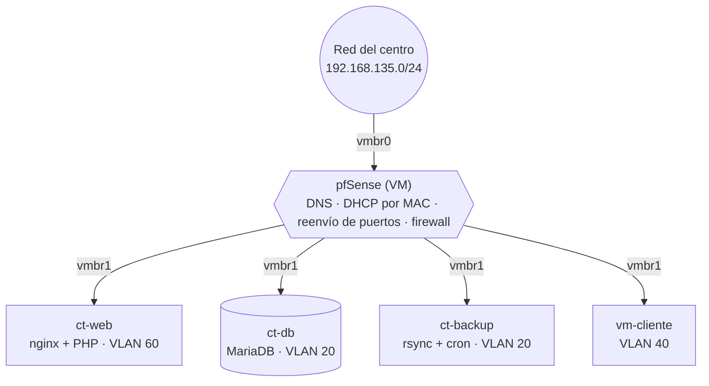

## **Estado**

<table data-search="false"><thead><tr><th width="384">Elemento</th><th>Resultado</th></tr></thead><tbody><tr><td>Red del centro → <code>vmbr0</code> → pfSense</td><td>Hecho: la WAN recibe IP por DHCP</td></tr><tr><td>VLANs 10, 20, 30, 40, 50 y 60 sobre <code>vmbr1</code></td><td>Hecho</td></tr><tr><td>Reglas del firewall por VLAN</td><td>Hecho</td></tr><tr><td>DHCP por MAC (VLAN 40) y DNS en pfSense</td><td>Hecho</td></tr><tr><td><code>ct-web</code> (NGINX y PHP-FPM) y <code>ct-db</code> (MariaDB)</td><td>Hecho</td></tr><tr><td>Reenvío de puertos hacia NGINX</td><td>Hecho</td></tr><tr><td><code>ct-backup</code></td><td>Hecho</td></tr></tbody></table>

***

## **1. pfSense**

La WAN va por `vmbr0` y recibe su IP por DHCP del centro. Las seis VLANs internas llegan por una única tarjeta virtual, que no lleva etiqueta de VLAN, y pfSense crea una interfaz por cada una.

<figure>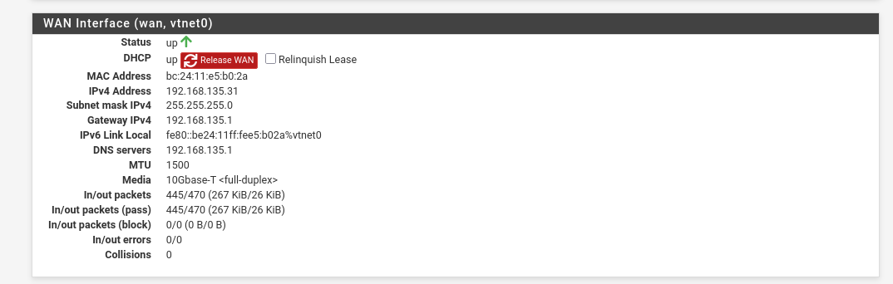<figcaption></figcaption></figure>

<table data-search="false"><thead><tr><th>Interfaz</th><th>Descripción</th><th>IP</th></tr></thead><tbody><tr><td>WAN</td><td>Red del centro</td><td>Por DHCP</td></tr><tr><td>LAN</td><td>MGMT (VLAN 30)</td><td><code>10.0.30.1/24</code></td></tr><tr><td>OPT1</td><td>DMZ (VLAN 10)</td><td><code>10.0.10.1/24</code></td></tr><tr><td>OPT2</td><td>SERV (VLAN 20)</td><td><code>10.0.20.1/24</code></td></tr><tr><td>OPT3</td><td>USERS (VLAN 40)</td><td><code>10.0.40.1/24</code></td></tr><tr><td>OPT4</td><td>ATK (VLAN 50)</td><td><code>10.0.50.1/24</code></td></tr><tr><td>OPT5</td><td>WEB (VLAN 60)</td><td><code>10.0.60.1/24</code></td></tr></tbody></table>

### Reglas del firewall

pfSense bloquea por defecto todo lo que no esté permitido, y las reglas se evalúan de arriba abajo. En cada VLAN se permite el ping a la puerta de enlace y el DNS de pfSense, se bloquea el acceso a la administración de pfSense y se permite la salida a internet (todo lo que no sea la red interna, con el alias `RED_INTERNA` invertido). La VLAN 40 puede abrir la web y la VLAN 60 puede consultar la base de datos. La WAN, la DMZ y la VLAN del atacante no llevan reglas, así que lo bloquean todo.

| VLAN       | Reglas, de arriba abajo                                                                                        |
| ---------- | -------------------------------------------------------------------------------------------------------------- |
| SERV (20)  | Ping a pfSense, DNS a pfSense, bloqueo a pfSense, salida a internet                                            |
| USERS (40) | Ping a pfSense, DNS a pfSense, web (puertos 80 y 443) hacia `10.0.60.10`, bloqueo a pfSense, salida a internet |
| WEB (60)   | Ping a pfSense, DNS a pfSense, base de datos (3306) hacia `10.0.20.11`, bloqueo a pfSense, salida a internet   |

<figure><figcaption></figcaption></figure>


<figure><figcaption></figcaption></figure>


<figure><figcaption></figcaption></figure>


### DHCP por MAC y DNS

El servidor DHCP de pfSense reparte las IPs de la VLAN 40 del `.100` al `.200` y asigna una IP fija a cada equipo conocido según su dirección MAC. Los servidores llevan IP fija configurada en Proxmox, para que sigan funcionando si el DHCP falla.

El DNS Resolver de pfSense reenvía las consultas al DNS del centro y resuelve los nombres del laboratorio (`honeynet.lan`) con _host overrides_: `ct-web`, `www`, `ct-db` y `ct-backup`.

La prueba desde la VM cliente: recibe `10.0.40.10`, la IP asignada a su MAC, y el DNS de pfSense resuelve `www.honeynet.lan` a `10.0.60.10`, con una respuesta autoritativa.


<figure>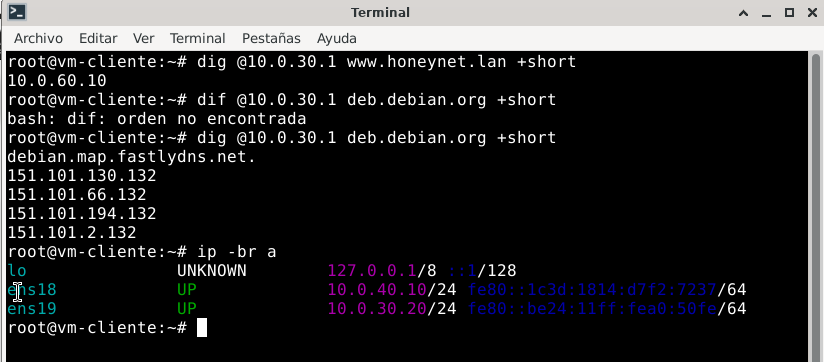<figcaption></figcaption></figure>


<figure>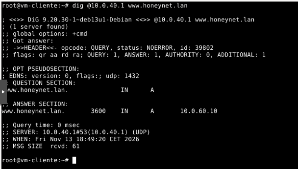<figcaption></figcaption></figure>

### Reenvío de puertos

La web se publica por la WAN de pfSense con una regla de NAT (puerto 80 de la WAN hacia `10.0.60.10`) y su regla asociada en la WAN, limitada a las redes del centro con un alias.

<figure>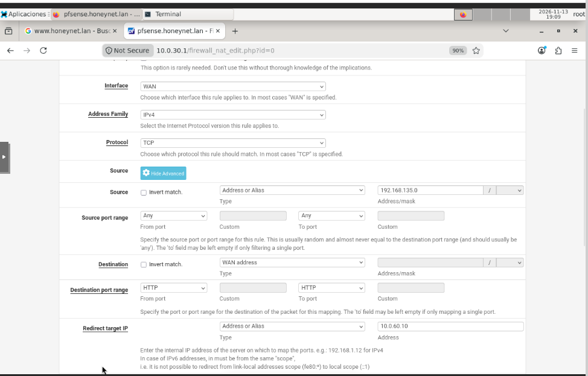<figcaption></figcaption></figure>


<figure>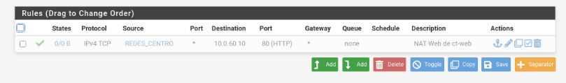<figcaption></figcaption></figure>


Desde un PC de otra red del centro:

```
PS> Test-NetConnection 192.168.135.31 -Port 80
TcpTestSucceeded : True
```

***

## **2. Contenedores `ct-db` y `ct-web`**

Los dos son contenedores LXC sin privilegios, con 256 MiB de RAM, en `vmbr1` con su VLAN y su IP fija, y usan a pfSense como puerta de enlace y como DNS.

| Contenedor | ID  | VLAN | IP              | Disco |
| ---------- | --- | ---- | --------------- | ----- |
| `ct-db`    | 211 | 20   | `10.0.20.11/24` | 3 GiB |
| `ct-web`   | 610 | 60   | `10.0.60.10/24` | 2 GiB |

<figure>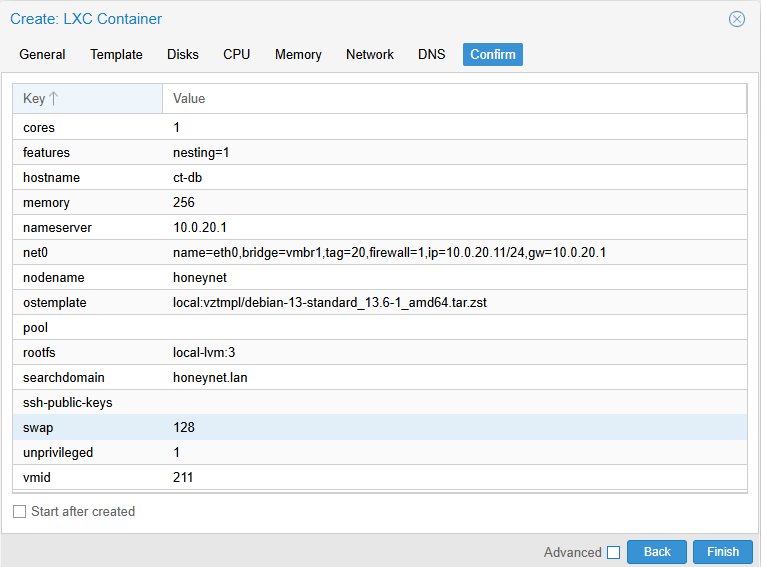<figcaption></figcaption></figure>


<figure>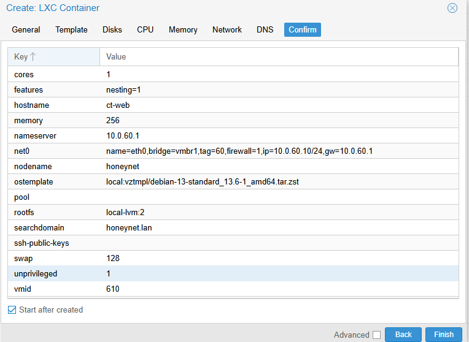<figcaption></figcaption></figure>


Salen a internet a través de pfSense, sin tarjetas temporales: el `ping` a la puerta de enlace y a `1.1.1.1` responde y `apt update` funciona.


<figure>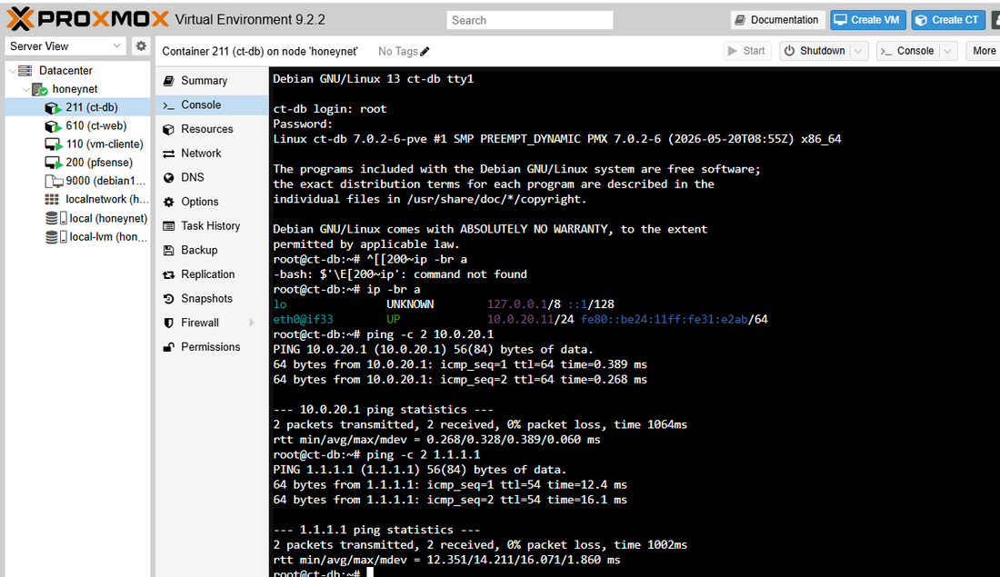<figcaption></figcaption></figure>

<figure>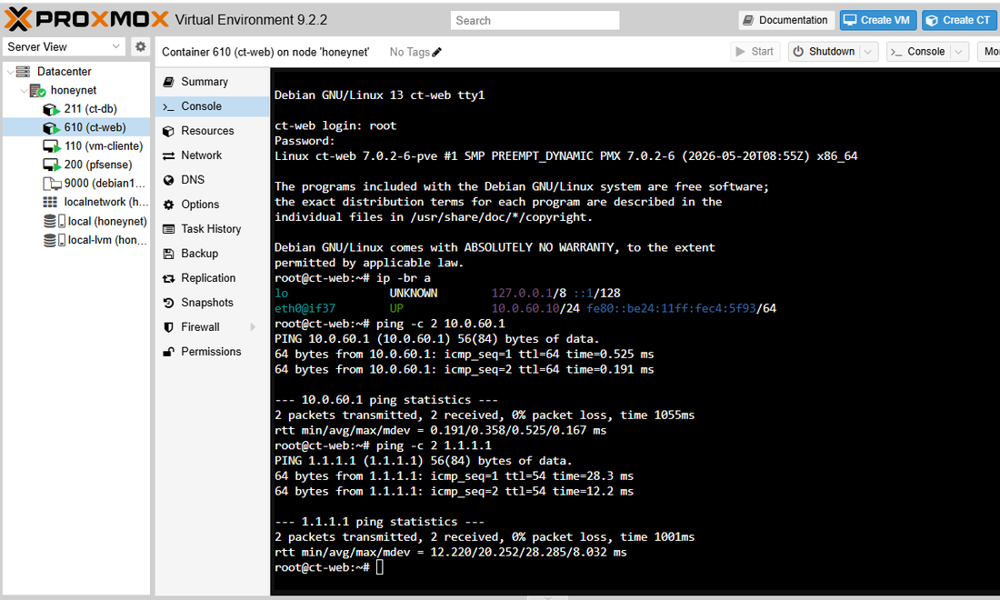<figcaption></figcaption></figure>


## **3. Base de datos**

En `ct-db` se instala MariaDB, que escucha solo en su IP interna, y se carga el script `honeypot_web.sql`, que crea las tablas, las vistas, los procedimientos, los triggers y los eventos. La web usa un usuario que solo puede ejecutar procedimientos (ver [Diagrama de la base de datos](../introduccion-al-proyecto/arquitectura-del-software/3.-diagrama-de-la-base-de-datos.md)).


<figure>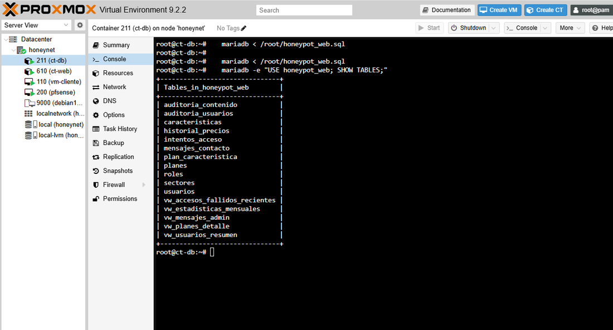<figcaption></figcaption></figure>


## **4. Prueba de punta a punta**

Desde la VM cliente (VLAN 40), el navegador abre `www.honeynet.lan` escribiendo `http://` delante: el DHCP da la IP, el DNS de pfSense resuelve el nombre, el firewall deja pasar el puerto 80, NGINX ejecuta PHP y PHP llama a un procedimiento de la base de datos, que devuelve los tres planes con sus características.

<figure><figcaption></figcaption></figure>

***

## **Problemas encontrados y soluciones**

| Problema                                            | Causa                                                          | Solución                                                                                     |
| --------------------------------------------------- | -------------------------------------------------------------- | -------------------------------------------------------------------------------------------- |
| El DNS Resolver no se podía activar en modo reenvío | Faltaba un servidor DNS en la configuración general de pfSense | Escribir el DNS del centro en _System → General Setup_                                       |
| `www.honeynet.lan` no cargaba en el navegador       | Firefox lo buscaba en Google                                   | Escribirlo con `http://` delante                                                             |
| Error 500 en la web                                 | PHP no podía conectar a la base de datos: _Access denied_      | Cambiar la contraseña del usuario de la web y desactivar la resolución de nombres en MariaDB |
| La web no se veía desde otro PC                     | La regla de NAT estaba deshabilitada                           | Activarla                                                                                    |

