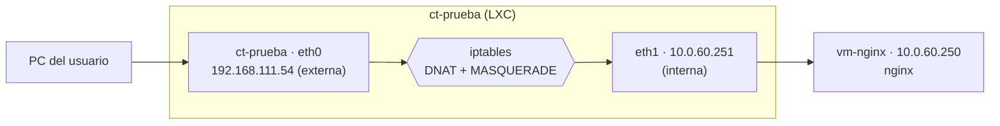

# Reenvío de puertos con iptables

## Objetivo

Que la web de `vm-nginx`, que solo está en la red interna, se vea desde el navegador de un PC entrando por la **IP externa del contenedor** `ct-prueba`. Es lo mismo que hará pfSense en la Fase 2: recibir el tráfico por la WAN y reenviarlo a la web interna.



## Conceptos

* **DNAT**: cambia el destino de un paquete. Lo que llega a la IP externa del contenedor por el puerto 80 se redirige a la VM, a su puerto 80.
* **MASQUERADE**: cambia el origen del paquete por la IP interna del contenedor, para que la VM pueda contestarle (la VM no sabe llegar al PC).
* **`ip_forward`**: por defecto Linux no pasa paquetes de una tarjeta a otra. Hay que activarlo.
* **FORWARD**: la cadena que decide qué tráfico reenviado se permite.

***

## 1. Preparar las máquinas

| Máquina     | Tarjetas                                                                                     |
| ----------- | -------------------------------------------------------------------------------------------- |
| `vm-nginx`  | Solo `ens19`: bridge `vmbr1`, etiqueta `60`, `10.0.60.250/24`                                |
| `ct-prueba` | `eth0`: bridge `vmbr0`, red externa. `eth1`: bridge `vmbr1`, etiqueta `60`, `10.0.60.251/24` |

Antes de seguir, desde el contenedor, un `curl` a la IP interna de la VM debe mostrar su página. La preparación de la red interna está en la página [Red interna con VLAN](red-interna-con-vlan-vmbr1.md).


CAPTURA PENDIENTE: las dos tarjetas de `ct-prueba` y su `ip -br a`.


## 2. Instalar y activar el reenvío

```bash
apt update && apt install iptables -y
sysctl -w net.ipv4.ip_forward=1
echo "net.ipv4.ip_forward=1" > /etc/sysctl.d/99-forward.conf
```

La comprobación es `sysctl net.ipv4.ip_forward`, que debe mostrar `1`. El archivo del tercer comando hace que el reenvío siga activo tras reiniciar.

## 3. Las reglas

```bash
iptables -t nat -A PREROUTING -i eth0 -p tcp --dport 80 -j DNAT --to-destination 10.0.60.250:80
iptables -t nat -A POSTROUTING -o eth1 -j MASQUERADE
iptables -A FORWARD -i eth0 -o eth1 -p tcp -d 10.0.60.250 --dport 80 -j ACCEPT
iptables -A FORWARD -i eth1 -o eth0 -m state --state ESTABLISHED,RELATED -j ACCEPT
iptables -P FORWARD DROP
```

| Regla                          | Qué hace                                                                            |
| ------------------------------ | ----------------------------------------------------------------------------------- |
| `PREROUTING` con `DNAT`        | Redirige el puerto 80 que entra por `eth0` a la VM                                  |
| `POSTROUTING` con `MASQUERADE` | Cambia el origen para que la VM responda al contenedor                              |
| `FORWARD` (ida)                | Permite reenviar solo el tráfico web a esa máquina                                  |
| `FORWARD` (vuelta)             | Permite las respuestas                                                              |
| `-P FORWARD DROP`              | **Denegar por defecto**: todo lo que no está permitido se bloquea. Se pone al final |


CAPTURA PENDIENTE: las reglas con `iptables -t nat -L -n -v` y `iptables -L FORWARD -n -v`.


## 4. Probar

Desde el navegador del PC se abre la IP externa del contenedor, con `http` y sin puerto, y debe mostrarse el mensaje de la VM. Los contadores (`pkts`) de la regla `DNAT` suben cada vez que se recarga la página. Otro puerto, por ejemplo el 8080, no responde: lo bloquea la política por defecto.


CAPTURA PENDIENTE: la web abierta en el navegador con la IP del contenedor.

