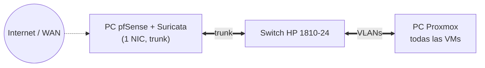
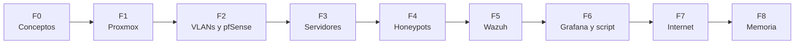

# Introducción al proyecto

## Resumen

**HoneyNet** es el proyecto de fin de ciclo de 2º de ASIX, orientado a ciberseguridad: una red de laboratorio completa, aislada mediante VLANs, diseñada para **atraer, capturar y analizar ataques reales** mediante honeypots, mientras un SIEM centraliza y correlaciona todo lo que ocurre.

En esencia, replica —a pequeña escala— lo que hacen los equipos de ciberseguridad de una empresa para estudiar cómo atacan los hackers: exponer un señuelo controlado, observar qué hacen los atacantes dentro de él, y reaccionar.


**Entrega**: febrero–marzo.

**Equipo**: Alex (responsable del proyecto) y David (colaborador).


***

## Motivación

El proyecto nace del interés personal por la ciberseguridad ofensiva y defensiva, con la idea de continuar en ese campo profesionalmente. Una HoneyNet es un ejercicio especialmente completo porque obliga a dominar, a la vez, redes, virtualización, hardening, automatización y análisis de datos — prácticamente todo el temario de 2º de ASIX aplicado a un caso real.

***

## Objetivos del proyecto

* Montar una infraestructura de red segmentada (VLANs) con un hipervisor bare-metal (**Proxmox**) como base.
* Desplegar varios **honeypots** (Cowrie, Dionaea, DVWA) que simulen servicios vulnerables reales.
* Centralizar y correlacionar los eventos de seguridad con un **SIEM** (Wazuh) y visualizarlos en **Grafana**.
* Automatizar, en la medida de lo posible, la respuesta ante ataques (bloqueo de IPs, alertas por Telegram).
* Documentar todo el proceso como si fuera un entorno de producción: decisiones de arquitectura, no solo comandos.

El detalle está en [Objetivos del proyecto](objetivos-del-proyecto.md).

***

## Arquitectura general

El proyecto se construye sobre dos PCs del centro conectados por un switch **HP 1810-24**: un PC con **Proxmox** como hipervisor (sin Windows ni ningún sistema operativo intermedio debajo), que aloja todas las VMs, y otro PC dedicado a **pfSense + Suricata** en hardware real, que actúa de firewall, router e IDS entre cinco VLANs.

| VLAN | Nombre     | Contenido                                                  |
| ---- | ---------- | ---------------------------------------------------------- |
| 10   | DMZ        | Honeypots: Cowrie, Dionaea, DVWA (en Docker)               |
| 20   | Servidores | DNS (Bind9), DHCP (isc-dhcp-server), MySQL, Backup (rsync) |
| 30   | Gestión    | Wazuh (SIEM) y Grafana (en Docker)                         |
| 40   | Usuarios   | VM Windows/Linux simulando empleados                       |
| 99   | WAN        | Kali Linux como máquina atacante                           |


El hardware se detalla en [Infraestructura física](infraestructura-fisica.md). El razonamiento de seguridad detrás de cada VLAN —qué puede hablar con qué, y por qué— está en [F0 — Profundización completa](../f0-profundizacion-completa/) y en el [Diagrama de red](diagrama-de-red.md).


Como pieza final, un **script en Python** leerá los logs de Cowrie, consultará AbuseIPDB, guardará los datos en MySQL, enviará alertas por Telegram y bloqueará IPs automáticamente en pfSense vía su API. Es la parte más ambiciosa del proyecto y no está garantizado que llegue a completarse en esta primera versión.

***

## Cronograma por fases

| Fase   | Contenido                                                                      |
| ------ | ------------------------------------------------------------------------------ |
| **F0** | Profundización conceptual: Proxmox, Docker, VLANs de seguridad, stack completo |
| **F1** | Instalación de Proxmox                                                         |
| **F2** | VLANs, switch y pfSense (+ Suricata)                                           |
| **F3** | Servidores internos (DNS, DHCP, MySQL, Backup)                                 |
| **F4** | Honeypots (Cowrie, Dionaea, DVWA)                                              |
| **F5** | Wazuh (SIEM)                                                                   |
| **F6** | Grafana, Telegram y script de respuesta automática                             |
| **F7** | Exposición controlada a internet                                               |
| **F8** | Memoria y presentación                                                         |

El estado de cada fase se sigue en la [Checklist / estado del proyecto](checklist-estado-del-proyecto.md).

***

## Parte web

Además de la infraestructura, el proyecto incluye la web de la empresa del proyecto, una empresa de ciberseguridad que ofrece honeypots como servicio. Más información en [Parte web](parte-web/).

***

## Equipo

* **Alex** — responsable del proyecto (recae sobre su nota); perfil técnico en redes y administración de sistemas; perfeccionista y autónomo.
* **David** — colaborador; conocimientos de redes y seguridad reforzados con sus prácticas actuales de empresa; perfeccionista y observador.

El razonamiento detrás de cómo se formó el equipo está en [Defensa del equipo](defensa-del-equipo.md).

***

## Punto de partida

Conocimientos ya consolidados antes de empezar: VLANs, OSPF, NAT/PAT, scripting en Bash, PHP/MySQL, Python básico.

Por aprender durante el proyecto: Proxmox, Docker, pfSense, Wazuh, Grafana — de ahí que exista una Fase 0 dedicada únicamente a profundizar en estos conceptos antes de instalar nada.

## Próximos pasos

* Seguir con [F0 — Profundización completa](../f0-profundizacion-completa/).
