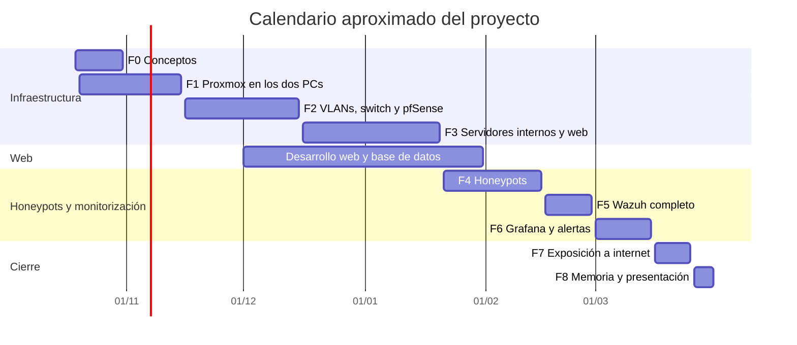

# 1. Planificación y funcionalidades

## Matriz de requisitos y funcionalidades

Cada función tiene una prioridad según su impacto en el MVP, un disparador concreto y una fecha aproximada de entrega.

| ID   | Prioridad | Objetivo                                  | Funcionalidad                                                                                                                       | Disparador                                                                  | Fecha entrega | Estado    |
| ---- | --------- | ----------------------------------------- | ----------------------------------------------------------------------------------------------------------------------------------- | --------------------------------------------------------------------------- | ------------- | --------- |
| ID1  | Alta      | Presentar la empresa y su servicio        | Web pública con vídeo principal, Inicio, Sobre nosotros, Sectores y Planes                                                          | Al abrir la URL se reproduce el vídeo y, al terminar, se redirige a Inicio  | 15/01/2027    | Pendiente |
| ID2  | Alta      | Captar clientes interesados               | Formulario de contacto (nombre, apellidos, teléfono y mensaje) que guarda el mensaje en la base de datos y muestra una confirmación | Clic en el botón «Enviar mensaje»                                           | 22/01/2027    | Pendiente |
| ID3  | Media     | Mostrar los planes de contratación        | Página de planes con tarjetas cargadas desde la base de datos (nombre, precio mensual y características)                            | Carga de /planes o clic en el botón de Inicio                               | 22/01/2027    | Pendiente |
| ID4  | Media     | Administrar el sitio de forma segura      | Login de administrador con sesión y contraseña guardada con hash                                                                    | Botón de acceso en la barra de navegación, que lleva a la pantalla de login | 29/01/2027    | Pendiente |
| ID5  | Media     | Consultar los ataques capturados          | Panel con una tabla de los logs de los honeypots, leída de la base de datos                                                         | Inicio de sesión como administrador                                         | 28/02/2027    | Pendiente |
| ID6  | Media     | Visualizar estadísticas de los ataques    | Gráficos de Grafana incrustados en el panel de administración                                                                       | Clic en la pestaña «Gráficos» tras iniciar sesión                           | 15/03/2027    | Pendiente |
| ID7  | Alta      | Acceder a la web por un dominio propio    | DNS (Bind9) que resuelve el dominio del proyecto hacia el servidor web                                                              | El navegador del cliente consulta el nombre de dominio                      | 15/12/2026    | Pendiente |
| ID8  | Alta      | Asignar direcciones IP automáticamente    | DHCP con rango protegido (IPs estáticas reservadas para servidores y rango dinámico para clientes) y relay en pfSense               | Arranque del cliente                                                        | 20/12/2026    | Pendiente |
| ID9  | Alta      | Publicar la web a través del gateway      | Reenvío de puertos en pfSense desde la WAN hacia el puerto web del servidor                                                         | Petición HTTP/HTTPS que llega a la interfaz WAN                             | 20/01/2027    | Pendiente |
| ID10 | Alta      | Proteger los servidores                   | Cortafuegos UFW con mínimo privilegio (la base de datos solo acepta al servidor web) y SSH con claves                               | Arranque del servidor o intento de conexión                                 | 20/01/2027    | Pendiente |
| ID11 | Media     | Proteger los datos ante pérdidas          | Copias de seguridad nocturnas de la base de datos y de las configuraciones con rsync y cron                                         | Tarea programada a las 03:00                                                | 20/01/2027    | Pendiente |
| ID12 | Baja      | Usar el sitio desde cualquier dispositivo | Diseño responsive con Bootstrap                                                                                                     | Carga de la web desde un móvil o una ventana estrecha                       | 31/01/2027    | Pendiente |
| ID13 | Alta      | Llevar el control de versiones            | Repositorio Git en GitHub con el código y la documentación                                                                          | Cada `git push`                                                             | 15/11/2026    | Pendiente |

## Leyenda

* **Prioridad**: Baja, Media o Alta, según el impacto en el MVP del proyecto.
* **Requisito**: qué necesita el cliente o el usuario.
* **Funcionalidad**: cómo el software va a resolver esa necesidad.
* **Disparador**: acción (clic, carga de página, tarea programada) que inicia la función.
* **Estado**: Activo, Pendiente o Cancelado.

## Calendario aproximado


Las fechas son aproximadas y se revisarán al terminar cada fase. El detalle de las fases está en la [Checklist del proyecto](../checklist-estado-del-proyecto.md).

