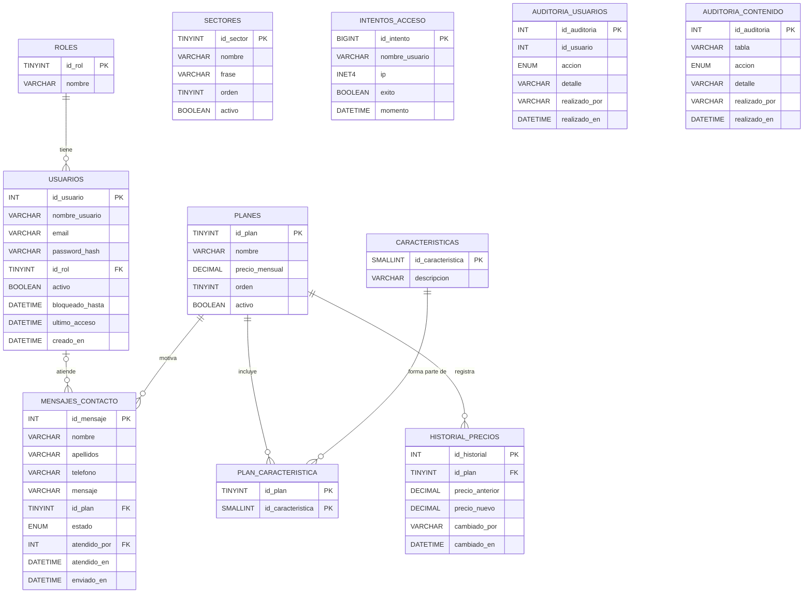

# 3. Diagrama de la base de datos

## Diagrama entidad-relación



`SECTORES` no tiene relaciones: son contenido fijo de la web. `INTENTOS_ACCESO` guarda el nombre de usuario como texto, sin clave foránea, para poder registrar también los intentos con usuarios que no existen. Las tablas de auditoría tampoco llevan clave foránea a propósito: el registro debe sobrevivir a la baja del usuario. Los **ataques capturados no se guardan en esta base de datos**: los registra Wazuh y los muestra Grafana.

## Reflexiones de diseño

**¿Qué datos son estrictamente necesarios?** Los que muestra o recibe la web: planes con sus características, sectores, mensajes del formulario de contacto y la cuenta del administrador. Se añaden los que hacen falta para proteger el login (intentos de acceso) y para saber quién cambió qué (auditoría). No se guardan datos que no se usen.

**¿Qué tipos de usuarios o roles hay y qué datos se recopilan?**

| Rol                   | Datos que se guardan                                                                    |
| --------------------- | --------------------------------------------------------------------------------------- |
| Visitante (sin login) | Solo lo que escribe en el formulario de contacto: nombre, apellidos, teléfono y mensaje |
| Administrador         | Nombre de usuario, email, contraseña cifrada y sus accesos al panel                     |

**¿Qué tipo de dato es el óptimo para cada campo?**

| Tabla              | Campo            | Tipo                       | Motivo                                                     |
| ------------------ | ---------------- | -------------------------- | ---------------------------------------------------------- |
| roles              | id\_rol          | TINYINT UNSIGNED           | Habrá muy pocos roles                                      |
| usuarios           | nombre\_usuario  | VARCHAR(50) UNIQUE         | Límite de longitud y sin duplicados                        |
| usuarios           | email            | VARCHAR(100) UNIQUE        | Longitud razonable para un email                           |
| usuarios           | password\_hash   | VARCHAR(255)               | Espacio suficiente para un hash bcrypt o argon2id          |
| usuarios           | activo           | BOOLEAN                    | Desactivar una cuenta sin borrarla                         |
| usuarios           | bloqueado\_hasta | DATETIME NULL              | Hasta cuándo está bloqueada tras demasiados fallos         |
| planes             | precio\_mensual  | DECIMAL(8,2) NULL          | Dinero con exactitud; NULL cuando el plan es «a consultar» |
| planes             | activo           | BOOLEAN                    | Los planes no se borran, se desactivan                     |
| caracteristicas    | descripcion      | VARCHAR(150)               | Una línea de la lista de lo que incluye cada plan          |
| sectores           | nombre / frase   | VARCHAR(50) / VARCHAR(200) | Texto corto de cada tarjeta                                |
| mensajes\_contacto | telefono         | VARCHAR(20)                | Admite prefijo internacional y espacios                    |
| mensajes\_contacto | mensaje          | VARCHAR(1000)              | Límite de caracteres para evitar abusos                    |
| mensajes\_contacto | estado           | ENUM                       | Nuevo, leído, respondido o archivado                       |
| intentos\_acceso   | ip               | INET4                      | Tipo propio de MariaDB para IPv4: valida y ocupa 4 bytes   |

**¿Están las tablas normalizadas?** Sí, hasta tercera forma normal: cada campo depende solo de su clave y no hay datos repetidos. La relación **N:M** entre planes y características se resuelve con la tabla intermedia `plan_caracteristica`, cuya clave primaria es la pareja (`id_plan`, `id_caracteristica`). Así, una característica como «Soporte 24/7» se escribe una sola vez aunque pertenezca a varios planes.

**Restricciones:** además de las claves, hay comprobaciones (`CHECK`): el nombre de usuario tiene al menos 3 caracteres, el precio no es negativo y el teléfono cumple un formato.

## Objetos programados de la base de datos

### Procedimientos almacenados

La web **no accede a las tablas**: solo ejecuta procedimientos. Cada uno de los dos usuarios de la base de datos puede ejecutar los suyos.

| Zona           | Procedimiento                                                                           | Qué hace                                                                                               |
| -------------- | --------------------------------------------------------------------------------------- | ------------------------------------------------------------------------------------------------------ |
| Pública        | `sp_listar_planes`                                                                      | Devuelve los planes activos con sus características                                                    |
| Pública        | `sp_listar_sectores`                                                                    | Devuelve los sectores activos                                                                          |
| Pública        | `sp_registrar_mensaje`                                                                  | Guarda el formulario de contacto dentro de una transacción                                             |
| Pública        | `sp_obtener_usuario_login`                                                              | Devuelve el hash para comprobarlo con `password_verify`; rechaza las cuentas bloqueadas o desactivadas |
| Pública        | `sp_registrar_intento_acceso`                                                           | Anota cada intento de login, correcto o fallido                                                        |
| Administración | `sp_crear_admin`, `sp_cambiar_password`, `sp_desbloquear_usuario`                       | Gestión de los administradores                                                                         |
| Administración | `sp_listar_mensajes`, `sp_cambiar_estado_mensaje`                                       | Ver los mensajes y cambiar su estado                                                                   |
| Administración | `sp_estadisticas_contacto`, `sp_mensajes_por_plan`                                      | Informes                                                                                               |
| Administración | `sp_crear_plan`, `sp_cambiar_precio`, `sp_desactivar_plan`, `sp_asociar_caracteristica` | Gestión de los planes                                                                                  |
| Administración | `sp_crear_sector`                                                                       | Alta de sectores                                                                                       |
| Mantenimiento  | `sp_purgar_mensajes`, `sp_purgar_accesos`                                               | Borran datos antiguos (mínimo 30 días)                                                                 |

### Triggers

| Trigger                               | Tabla              | Qué hace                                                                                       |
| ------------------------------------- | ------------------ | ---------------------------------------------------------------------------------------------- |
| `trg_usuarios_bi` y `trg_usuarios_bu` | usuarios           | Normalizan el email y exigen que la contraseña llegue cifrada (bcrypt o argon2)                |
| `trg_usuarios_bu`                     | usuarios           | Impide desactivar al último administrador                                                      |
| `trg_usuarios_bd`                     | usuarios           | Impide borrar al último administrador                                                          |
| `trg_usuarios_ai`, `_au` y `_ad`      | usuarios           | Auditoría de altas, cambios (incluidos bloqueos) y bajas                                       |
| `trg_accesos_ai`                      | intentos\_acceso   | Anota el último acceso correcto y **bloquea la cuenta 15 minutos tras 5 fallos en 15 minutos** |
| `trg_mensajes_bi`                     | mensajes\_contacto | Limpia y valida el formulario y frena el spam: máximo 3 mensajes por teléfono cada 10 minutos  |
| `trg_mensajes_bu`                     | mensajes\_contacto | Anota la fecha en que se lee o responde un mensaje                                             |
| `trg_planes_ai` y `_au`               | planes             | Historial de precios y auditoría de altas y desactivaciones                                    |
| `trg_planes_bd`                       | planes             | Impide borrar un plan: se desactiva                                                            |
| `trg_sectores_ai`                     | sectores           | Auditoría de altas                                                                             |

### Vistas, funciones y eventos

| Tipo    | Nombre                          | Qué hace                                                |
| ------- | ------------------------------- | ------------------------------------------------------- |
| Vista   | `vw_planes_detalle`             | Cada plan con sus características en una sola fila      |
| Vista   | `vw_mensajes_admin`             | Mensajes con el nombre del plan y de quien los atendió  |
| Vista   | `vw_estadisticas_mensuales`     | Mensajes recibidos, atendidos y sin leer por mes        |
| Vista   | `vw_usuarios_resumen`           | Usuarios sin el hash de la contraseña                   |
| Vista   | `vw_accesos_fallidos_recientes` | Accesos fallidos de las últimas 24 horas                |
| Función | `fn_precio_anual`               | Precio anual con descuento                              |
| Función | `fn_num_mensajes_plan`          | Número de mensajes de un plan                           |
| Función | `fn_cuenta_bloqueada`           | Indica si una cuenta está bloqueada ahora               |
| Evento  | `ev_purgar_mensajes`            | Cada mes borra los mensajes archivados de más de un año |
| Evento  | `ev_purgar_accesos`             | Cada semana borra los accesos de más de 90 días         |

Los eventos necesitan `event_scheduler=ON` en MariaDB.

### Ejemplo: el bloqueo de la cuenta tras cinco fallos

```sql
CREATE TRIGGER trg_accesos_ai AFTER INSERT ON intentos_acceso
FOR EACH ROW
BEGIN
  DECLARE v_fallos INT;
  IF NEW.exito = 1 THEN
    UPDATE usuarios SET ultimo_acceso = NEW.momento
    WHERE nombre_usuario = NEW.nombre_usuario;
  ELSE
    SELECT COUNT(*) INTO v_fallos
    FROM intentos_acceso
    WHERE nombre_usuario = NEW.nombre_usuario AND exito = 0
      AND momento >= NEW.momento - INTERVAL 15 MINUTE;
    IF v_fallos >= 5 THEN
      UPDATE usuarios
      SET bloqueado_hasta = NEW.momento + INTERVAL 15 MINUTE
      WHERE nombre_usuario = NEW.nombre_usuario
        AND (bloqueado_hasta IS NULL OR bloqueado_hasta < NEW.momento);
    END IF;
  END IF;
END
```

## Script de creación y pruebas

El script completo (tablas, datos de ejemplo, vistas, funciones, procedimientos, triggers, eventos y usuarios) está en el archivo `honeypot_web.sql`, y sus pruebas en `honeypot_web_pruebas.sql`. Se cargan con:

```bash
mariadb -u root -p < honeypot_web.sql
mariadb -t --force -u root -p < honeypot_web_pruebas.sql
```

Las pruebas comprueban cada procedimiento y cada trigger, incluidos los casos que deben fallar (un mensaje demasiado corto, una contraseña sin cifrar, el cuarto mensaje seguido del mismo teléfono, borrar al último administrador...).


CAPTURA PENDIENTE: la salida de las pruebas, con alguno de los errores esperados.

