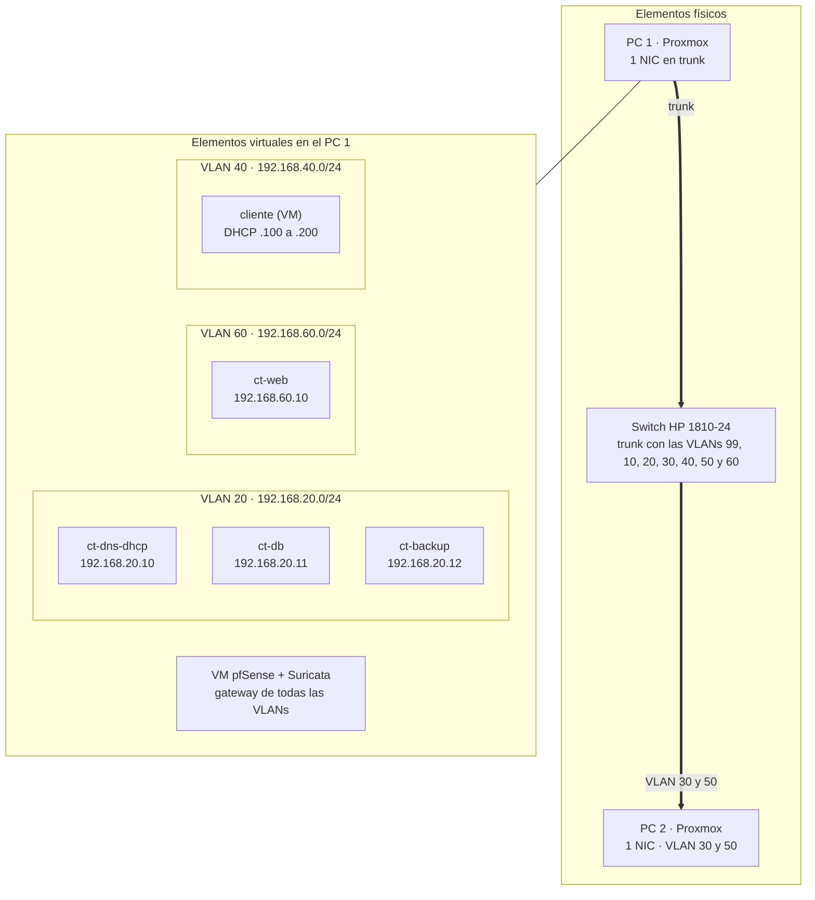

# 5. Infraestructura y red (Proxmox)

## Máquinas virtuales y contenedores

Todo el laboratorio de servicios corre en el **PC 1** (Proxmox). Los cuatro servidores del proyecto (base de datos, servidor web, DNS + DHCP y copias de seguridad) son contenedores LXC, que comparten el kernel de Proxmox y arrancan con muy poca RAM; el cliente es una VM.

| Máquina       | Tipo | Función                        | VLAN | IP            | Sistema                  | RAM     | Disco |
| ------------- | ---- | ------------------------------ | ---- | ------------- | ------------------------ | ------- | ----- |
| `ct-dns-dhcp` | LXC  | DNS (Bind9) y DHCP             | 20   | 192.168.20.10 | Debian 13                | 0,1 GB  | 1 GB  |
| `ct-db`       | LXC  | Base de datos (MariaDB)        | 20   | 192.168.20.11 | Debian 13                | 0,25 GB | 3 GB  |
| `ct-backup`   | LXC  | Copias de seguridad (rsync)    | 20   | 192.168.20.12 | Debian 13                | 0,15 GB | 2 GB  |
| `ct-web`      | LXC  | Servidor web (nginx + PHP-FPM) | 60   | 192.168.60.10 | Debian 13                | 0,15 GB | 2 GB  |
| `cliente`     | VM   | Cliente con navegador          | 40   | Por DHCP      | Debian 13 con escritorio | 1 GB    | 10 GB |

Los tres contenedores de la VLAN 20 suman 0,5 GB de RAM y 6 GB de disco, el mismo presupuesto que tenía el contenedor único de servidores. El resto del PC 1 lo ocupan la VM de pfSense + Suricata y la VM de los honeypots, y el PC 2 aloja el SIEM y Kali (ver [Infraestructura física](../infraestructura-fisica.md)).

## Plan de direccionamiento

| VLAN | Nombre     | Subred          | Puerta de enlace (pfSense) | Uso de las IPs                                                    |
| ---- | ---------- | --------------- | -------------------------- | ----------------------------------------------------------------- |
| 99   | WAN        | Red del centro  | —                          | Entrada de la red real del centro; direccionamiento por confirmar |
| 10   | DMZ        | 192.168.10.0/24 | 192.168.10.1               | Honeypots                                                         |
| 20   | Servidores | 192.168.20.0/24 | 192.168.20.1               | Servidores con IP estática reservada (.2 a .50)                   |
| 30   | Gestión    | 192.168.30.0/24 | 192.168.30.1               | Wazuh, Grafana y administración                                   |
| 40   | Usuarios   | 192.168.40.0/24 | 192.168.40.1               | Reservadas .2 a .99; rango dinámico .100 a .200                   |
| 50   | Atacante   | 192.168.50.0/24 | 192.168.50.1               | Kali                                                              |
| 60   | Web        | 192.168.60.0/24 | 192.168.60.1               | Servidor web                                                      |

## Diagrama de red: elementos físicos y virtuales



El esquema completo del laboratorio está en [Diagrama de red](../diagrama-de-red.md).

## Servicios de red

### DHCP con rango protegido

Los servidores tienen IP estática reservada y solo los clientes reciben direcciones dinámicas. pfSense actúa como **DHCP relay** y reenvía las peticiones de la VLAN 40 a `ct-dns-dhcp`.

```
subnet 192.168.20.0 netmask 255.255.255.0 {
}

subnet 192.168.40.0 netmask 255.255.255.0 {
  range 192.168.40.100 192.168.40.200;
  option routers 192.168.40.1;
  option domain-name-servers 192.168.20.10;
  option domain-name "honeypot.com";
}
```

### DNS con dominio propio

`ct-dns-dhcp` es el servidor autoritativo de `honeypot.com` (ver el apunte _Servidor DNS con Bind9 en Debian 13_):

```
ns1     IN  A   192.168.20.10
www     IN  A   192.168.60.10
db      IN  A   192.168.20.11
backup  IN  A   192.168.20.12
```

## Routing y NAT

El gateway virtual es **pfSense**. El reenvío de puertos (Port Forward) redirige el tráfico web que llega a la interfaz WAN (la red real del centro) hacia el servidor web de la VLAN 60:

| Interfaz | Protocolo | Puerto de destino | Redirigir a       | Descripción          |
| -------- | --------- | ----------------- | ----------------- | -------------------- |
| WAN      | TCP       | 80                | 192.168.60.10:80  | HTTP hacia `ct-web`  |
| WAN      | TCP       | 443               | 192.168.60.10:443 | HTTPS hacia `ct-web` |

Solo se abren estos dos puertos; el resto del tráfico desde la WAN sigue bloqueado.

## Comprobaciones de la infraestructura

* [ ] Cuatro servidores en marcha: base de datos, servidor web, DNS + DHCP y copias de seguridad.
* [ ] Cliente que solicita IP por DHCP para conectar a la web.
* [ ] DHCP con rango protegido: IPs estáticas reservadas para servidores y rango dinámico para clientes.
* [ ] DNS que resuelve el dominio propio hacia las IPs correspondientes.
* [ ] Reenvío de puertos desde el gateway virtual al puerto web del servidor.
* [ ] Diagrama de red que diferencia elementos físicos y virtuales (IPs, subredes e interfaces).
