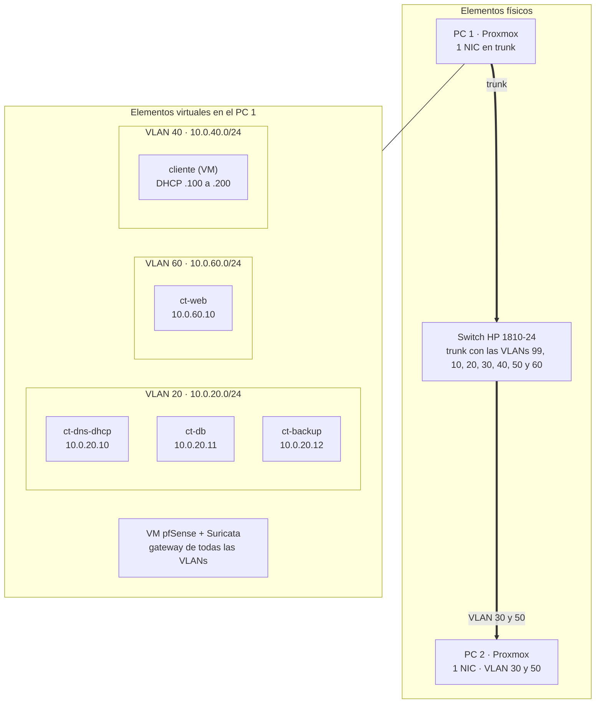

# 5. Infraestructura y red (Proxmox)

## Máquinas virtuales y contenedores

Los cuatro servidores del proyecto (base de datos, servidor web, DNS + DHCP y copias de seguridad) son contenedores LXC del **PC 1** (Proxmox), que comparten el kernel y arrancan con muy poca RAM; el cliente es una VM.

| Máquina       | Tipo | Función                        | VLAN | IP         | Sistema                  | RAM     | Disco |
| ------------- | ---- | ------------------------------ | ---- | ---------- | ------------------------ | ------- | ----- |
| `ct-dns-dhcp` | LXC  | DNS (Bind9) y DHCP             | 20   | 10.0.20.10 | Debian 13                | 0,1 GB  | 1 GB  |
| `ct-db`       | LXC  | Base de datos (MariaDB)        | 20   | 10.0.20.11 | Debian 13                | 0,25 GB | 3 GB  |
| `ct-backup`   | LXC  | Copias de seguridad (rsync)    | 20   | 10.0.20.12 | Debian 13                | 0,15 GB | 2 GB  |
| `ct-web`      | LXC  | Servidor web (nginx + PHP-FPM) | 60   | 10.0.60.10 | Debian 13                | 0,25 GB | 2 GB  |
| `cliente`     | VM   | Cliente con navegador          | 40   | Por DHCP   | Debian 13 con escritorio | 1 GB    | 10 GB |

Los tres contenedores de la VLAN 20 suman 0,5 GB de RAM y 6 GB de disco. `ct-web` lleva 0,25 GB porque nginx con PHP-FPM necesita algo más que un servidor estático. El resto del PC 1 lo ocupan la VM de pfSense + Suricata y la VM de los honeypots, y el PC 2 aloja el SIEM (Wazuh y Grafana) y Kali (ver [Infraestructura física](../infraestructura-fisica.md)).

## Red interna y red externa

Para distinguir de un vistazo lo que es del laboratorio y lo que es del centro, se usan dos rangos distintos:

| Red                          | Rango              | Qué es                                                                                                                          |
| ---------------------------- | ------------------ | ------------------------------------------------------------------------------------------------------------------------------- |
| **Externa** (la del centro)  | `192.168.111.0/24` | La red real del centro. Es la VLAN 99 (WAN) y, de momento, la gestión de los Proxmox (por ejemplo, el PC 1 en `192.168.111.64`) |
| **Interna** (el laboratorio) | `10.0.X.0/24`      | Las redes del proyecto, una por VLAN. Solo existen dentro del laboratorio                                                       |

En la Fase 2, la gestión de los dos Proxmox pasa de la red del centro a la VLAN 30 (`10.0.30.0/24`).

## Plan de direccionamiento interno

| VLAN | Nombre     | Subred                            | Puerta de enlace (pfSense) | Uso de las IPs                                                                |
| ---- | ---------- | --------------------------------- | -------------------------- | ----------------------------------------------------------------------------- |
| 99   | WAN        | 192.168.111.0/24 (red del centro) | —                          | Entrada de la red real del centro                                             |
| 10   | DMZ        | 10.0.10.0/24                      | 10.0.10.1                  | Honeypots                                                                     |
| 20   | Servidores | 10.0.20.0/24                      | 10.0.20.1                  | Servidores con IP estática reservada (.2 a .50)                               |
| 30   | Gestión    | 10.0.30.0/24                      | 10.0.30.1                  | Wazuh y Grafana (VM SIEM en 10.0.30.10) y administración (Proxmox en .2 y .3) |
| 40   | Usuarios   | 10.0.40.0/24                      | 10.0.40.1                  | Reservadas .2 a .99; rango dinámico .100 a .200                               |
| 50   | Atacante   | 10.0.50.0/24                      | 10.0.50.1                  | Kali                                                                          |
| 60   | Web        | 10.0.60.0/24                      | 10.0.60.1                  | Servidor web                                                                  |

El DHCP de la VLAN 40 lo da `ct-dns-dhcp`, con pfSense como relay.

## Diagrama de red: elementos físicos y virtuales

El esquema completo del laboratorio está en [Diagrama de red](../diagrama-de-red.md).
