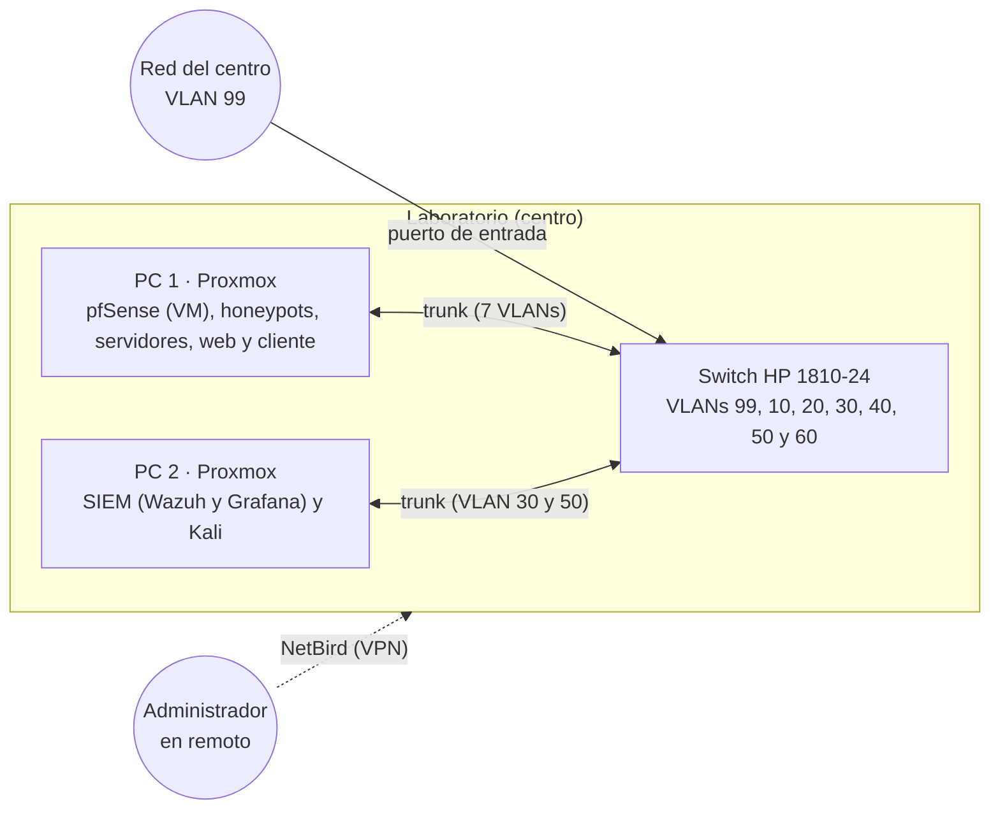
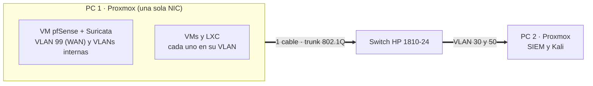
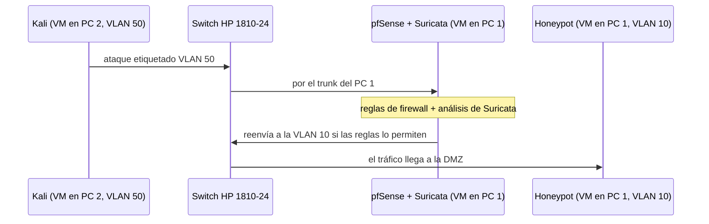

# 📡 Infraestructura física

## Introducción

Esta página describe el **hardware real** del laboratorio de HoneyNet: qué equipos se usan, cómo se conectan y qué decisiones se han tomado. Complementa al [Diagrama de red](diagrama-de-red.md), que muestra la arquitectura lógica (VLANs y reglas de tráfico).

***

## Inventario de hardware

| Equipo                                | Papel en el proyecto                                                                                                                                                                             | Estado                                                 |
| ------------------------------------- | ------------------------------------------------------------------------------------------------------------------------------------------------------------------------------------------------ | ------------------------------------------------------ |
| **PC 1: Proxmox «honeynet»**          | Intel i5-8500 (6 núcleos), 8 GB de RAM y SSD de 128 GB. Aloja la VM de **pfSense + Suricata**, los **honeypots**, los **servidores**, la **web** y la VM de **cliente**. Está siempre encendido. | ✅ En uso                                               |
| **PC 2: Proxmox «honeynet2»**         | 8 GB de RAM, un **disco duro de 500 GB** con Proxmox y un **SSD de 256 GB** libre. Tiene una sola tarjeta de red. Aloja el **SIEM** (Wazuh completo y Grafana) y **Kali**.                       | 🟡 Proxmox instalado; falta preparar el almacenamiento |
| **Switch HP 1810-24** (J9801A)        | Conecta los dos PCs y transporta las VLANs. Se encuentra en el centro.                                                                                                                           | 🟡 Reservado (se configura en la Fase 2)               |
| **Juniper NetScreen-25** (NS-025-005) | Firewall físico prestado por el centro.                                                                                                                                                          | ⏸️ Aparcado                                            |


Los dos PCs, el switch y el firewall son **material del centro**, no propio.



Cada PC tiene **8 GB de RAM** y el centro no puede ampliarlos. En disco, el PC 1 tiene un SSD de 128 GB (unos 54 GB para máquinas), y el PC 2 tiene bastante más. De esa limitación de memoria sale buena parte de las decisiones de diseño (ver más abajo).


***

## Topología física

***

## Cómo funciona con una sola tarjeta de red

Cada PC tiene **una sola NIC**, y un firewall normalmente necesita al menos dos (una para WAN y otra para LAN). La solución es usar **VLANs sobre un único cable**:

* El PC 1 va conectado al switch en modo **trunk**: por el mismo cable viajan todas las VLANs **etiquetadas** (802.1Q).
* **pfSense es una máquina virtual** del PC 1 con una tarjeta virtual que recibe todas las VLANs. La **VLAN 99** actúa como **WAN** y las VLANs 10, 20, 30, 40, 50 y 60 son las redes internas.
* pfSense crea una interfaz por cada VLAN sobre esa única tarjeta y enruta el tráfico entre ellas.

Esta técnica se conoce como **router on a stick**.


**Contrapartida**: todo el tráfico entre VLANs pasa por un único enlace físico. Para un laboratorio es suficiente, pero sería un cuello de botella en una red de producción.



Hasta que el switch esté configurado, la WAN de pfSense va por el bridge `vmbr0` (la red del centro, sin VLAN) y las VLANs internas por `vmbr1`, una red interna del propio nodo. Cuando llegue el switch, todo pasa al trunk.


### Recorrido de un ataque

Aunque el honeypot y pfSense estén en el mismo PC, el tráfico entre VLANs siempre tiene que pasar por pfSense:

***

## Reparto de recursos

**PC 1** (unos 7,6 GB de RAM y 54 GB para máquinas)

| Máquina                                          | Tipo    | RAM          | Disco       |
| ------------------------------------------------ | ------- | ------------ | ----------- |
| Proxmox                                          | Sistema | 1,4 GB       | —           |
| pfSense con Suricata                             | VM      | 2 GB         | 12 GB       |
| Honeypots (Docker)                               | VM      | 1 GB         | 10 GB       |
| Servidores: `ct-dns-dhcp`, `ct-db` y `ct-backup` | 3 LXC   | 0,65 GB      | 7 GB        |
| Web (`ct-web`: nginx + PHP-FPM)                  | LXC     | 0,25 GB      | 2 GB        |
| Cliente                                          | VM      | 1,5 GB       | 10 GB       |
| **Total**                                        |         | **≈ 6,8 GB** | **≈ 41 GB** |

Quedan unos 0,8 GB de margen de RAM en el PC 1. Si hiciera falta, la VM cliente puede apagarse cuando no se use.

**PC 2** (8 GB de RAM; el SIEM y Kali van en el SSD de 256 GB)

| Máquina                                 | Tipo    | RAM              | Disco       |
| --------------------------------------- | ------- | ---------------- | ----------- |
| Proxmox                                 | Sistema | 1,4 GB           | —           |
| SIEM (Docker: Wazuh completo y Grafana) | VM      | 4 GB             | 50 GB       |
| Kali (sin escritorio, solo en pruebas)  | VM      | 1,5-2 GB         | 20 GB       |
| **Total con Kali**                      |         | **≈ 6,9-7,4 GB** | **≈ 70 GB** |

***

## Decisiones tomadas

* **Dos Proxmox independientes**, uno por PC, sin clúster. Cada uno gestiona sus máquinas.
* **pfSense + Suricata va en una VM** del PC 1. Antes iba en hardware real, pero el PC dedicado casi no usaba su memoria y la RAM total era insuficiente.
* **Wazuh completo** (manager, indexador y panel) con **Grafana**, en el PC 2, con retención corta de datos. Los ataques se guardan en Wazuh y se ven en Grafana, no en la base de datos de la web.
* **El SIEM y Kali, en el SSD del PC 2**, porque el disco duro de ese equipo es lento para un indexador que escribe mucho.
* **Kali en el PC 2** y encendida solo durante las pruebas. El **cliente** va en el PC 1.
* Servicios internos en **tres contenedores LXC** (DNS y DHCP, base de datos y copias), más uno para la web, para ahorrar memoria y separar privilegios.
* **WAN como VLAN 99**, **VLAN 50** para el atacante y **VLAN 60** para la web.
* El **NetScreen-25 queda aparcado**: no forma parte de la arquitectura.
* **No hay portátil de administración fijo**: se administra desde un puerto del switch en la VLAN 30.


Si la VM de pfSense se apaga, cae el enrutado entre VLANs. El **puerto de administración** de la VLAN 30 sigue llegando a los dos Proxmox, porque no depende de pfSense.


***

## Acceso remoto con NetBird

Se puede trabajar en el laboratorio **desde casa** mediante **NetBird**, una VPN. Como los equipos están siempre encendidos, el laboratorio está disponible en cualquier momento.

***
