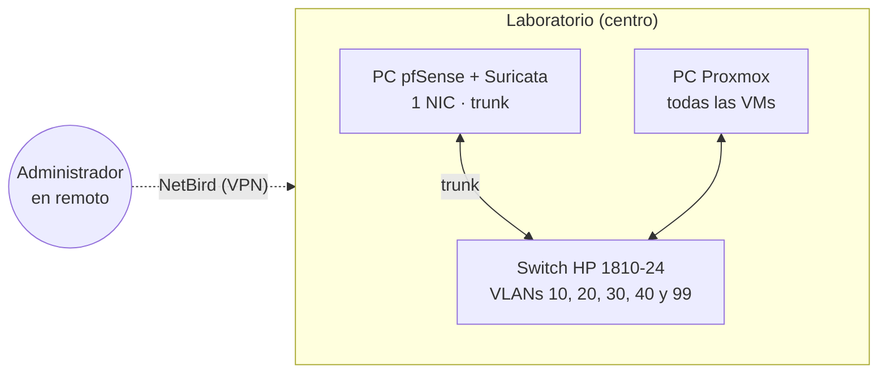
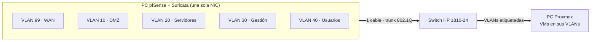
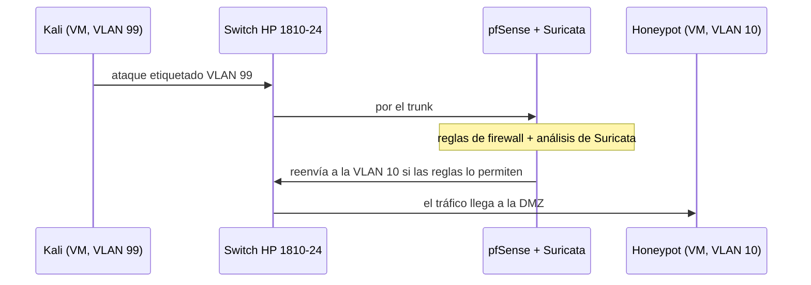

# Infraestructura física

## Introducción

Esta página describe el **hardware real** del laboratorio de HoneyNet: qué equipos se usan, cómo se conectan y qué decisiones se han tomado. Complementa al [Diagrama de red](diagrama-de-red.md), que muestra la arquitectura lógica (VLANs y reglas de tráfico).

***

## Inventario de hardware

| Equipo                                | Papel en el proyecto                                                                                          | Estado                                   |
| ------------------------------------- | ------------------------------------------------------------------------------------------------------------- | ---------------------------------------- |
| **PC con Proxmox**                    | Hipervisor instalado como sistema operativo. Aloja **todas las VMs** del laboratorio. Está siempre encendido. | ✅ En uso                                 |
| **PC dedicado a pfSense + Suricata**  | Firewall, router e IDS en **hardware real** (no en VM). Tiene **una sola tarjeta de red**.                    | 🟡 Reservado (se configura en la Fase 2) |
| **Switch HP 1810-24** (J9801A)        | Conecta los dos PCs y transporta las VLANs. Se encuentra en el centro.                                        | 🟡 Reservado (se configura en la Fase 2) |
| **Juniper NetScreen-25** (NS-025-005) | Firewall físico prestado por el centro.                                                                       | ⏸️ Aparcado                              |


Los dos PCs, el switch y el firewall son **material del centro**, no propio.


***

## Topología física

***

## Cómo funciona con una sola tarjeta de red

El PC de pfSense solo tiene **una NIC**, y un firewall normalmente necesita al menos dos (una para WAN y otra para LAN). La solución es usar **VLANs sobre un único cable**:

* La NIC va conectada al switch en modo **trunk**: por el mismo cable viajan todas las VLANs **etiquetadas** (802.1Q).
* La **VLAN 99** actúa como la **WAN**, y las VLANs 10, 20, 30 y 40 son las redes internas.
* pfSense crea una interfaz virtual por cada VLAN sobre esa única NIC y enruta el tráfico entre ellas.

Esta técnica se conoce como **router on a stick**.


**Contrapartida**: todo el tráfico entre VLANs pasa por un único enlace físico. Para un laboratorio es suficiente, pero sería un cuello de botella en una red de producción.


### Recorrido de un ataque

Aunque Kali y el honeypot estén en el mismo PC Proxmox, el tráfico entre VLANs siempre tiene que pasar por pfSense:

***

## Decisiones tomadas

* **pfSense + Suricata va en hardware real**, en el PC dedicado, no en una VM de Proxmox.
* **Un solo PC Proxmox** con todas las VMs (honeypots, servidores, gestión, usuarios y Kali).
* **WAN como VLAN 99** y resto de VLANs en trunk sobre la única NIC de pfSense.
* El **NetScreen-25 queda aparcado**: no forma parte de la arquitectura por ahora.
* **No hay portátil de administración fijo.**

***

## Acceso remoto con NetBird

Se puede trabajar en el laboratorio **desde casa** mediante **NetBird**, una VPN. Como el PC con Proxmox está siempre encendido, el laboratorio está disponible en cualquier momento.

***

## Por definir

* Reparto de puertos del switch (qué puerto va a cada PC) y configuración de las VLANs en el HP 1810-24.
* Dónde va conectada físicamente la salida a internet del laboratorio.

## Próximos pasos

* Documentar la configuración del switch en la **Fase 2**.
* Instalar y configurar NetBird para el acceso remoto.
* Actualizar esta página si cambia algún equipo o conexión.
