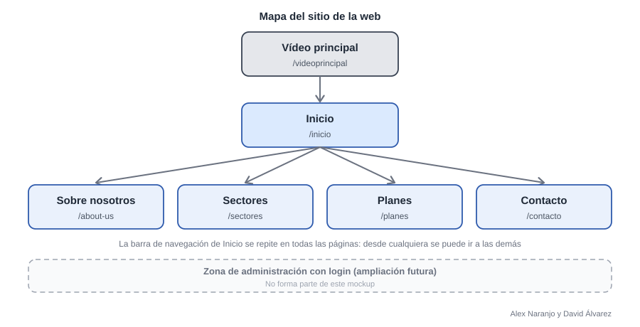

# Actividad M14UF1A2: diseño y plan de producción

Módulo Profesional 14: Proyecto Común. Actividad UF1. Ciclo Formativo de Grado Superior en ASIX.

Realizado por **Alex Naranjo y David Álvarez**.

## Funcionalidades de la web

La web es pública y ofrece estas funcionalidades al visitante:

* Ver el vídeo de presentación y entrar a la web.
* Moverse por todas las páginas con una barra de navegación que se repite arriba (logo y enlaces a Sobre nosotros, Sectores, Planes y Contacto).
* Conocer qué es un honeypot y qué servicio ofrece la empresa (Inicio y Sobre nosotros).
* Consultar los sectores a los que se dirige el servicio.
* Comparar los tres planes disponibles.
* Contactar con la empresa mediante un formulario que avisa de los errores y confirma el envío.

**Ampliación futura:** zona de administración con login, desde la que un administrador vea los paneles de ataques capturados.

## Mapa del sitio

La web es la de una empresa de ciberseguridad que ofrece un servicio de honeypots, para estudiar cómo atacan los hackers y así defender a otras empresas. Es un sitio público: se entra por un vídeo de presentación, que lleva a Inicio, y desde Inicio se llega al resto de páginas.

**Perfil de usuario:** en esta versión el sitio tiene un único perfil, el visitante (una empresa interesada en el servicio), y no hay zona de acceso con usuario y contraseña. Como ampliación futura está prevista una zona de administración con login (recuadro discontinuo del mapa), fuera del alcance de este mockup.

## Mockups y wireframes

Mockup hecho en Figma: [Mockup web de HoneyNet](https://www.figma.com/design/2hHxSq9MufPYlfE1gnFww0). La web de referencia para el estilo es [Two Rockets](https://www.tworockets.consulting/): portada con una propuesta clara y botones de acción, secciones cortas, planes y contacto siempre accesible.


Mockup de la web (Alex Naranjo y David Álvarez)


### Notas sobre cada pantalla

Cómo funciona la navegación y qué datos se muestran al visitante.

| Pantalla          | Elementos                                                                                                                                                          | Navegación                                                                                                                                                                                                         | Datos que se muestran al visitante                                                                                                                                                                                                                                                                                                                                                                                     |
| ----------------- | ------------------------------------------------------------------------------------------------------------------------------------------------------------------ | ------------------------------------------------------------------------------------------------------------------------------------------------------------------------------------------------------------------ | ---------------------------------------------------------------------------------------------------------------------------------------------------------------------------------------------------------------------------------------------------------------------------------------------------------------------------------------------------------------------------------------------------------------------- |
| `/videoprincipal` | Vídeo de presentación a pantalla completa sobre fondo negro.                                                                                                       | Al terminar el vídeo se redirige automáticamente a Inicio.                                                                                                                                                         | Vídeo corporativo que explica de forma breve qué es un honeypot y qué ofrece la empresa.                                                                                                                                                                                                                                                                                                                               |
| Inicio            | Barra de navegación (logo, enlaces y botón de acción). Bloque de texto, panel de ataques a la derecha, dos botones, sección «Cómo funciona» y llamada a la acción. | Logo: vuelve a Inicio. Enlaces de la barra: Sobre nosotros, Sectores, Planes y Contacto. Los dos botones llevan a Planes y a Contacto. El botón «Solicitar demo» y la llamada a la acción final llevan a Contacto. | Titular «Descubre cómo te atacan antes de que lo hagan de verdad», párrafo que explica el servicio y los botones «Ver planes» y «Contactar». A la derecha, un panel con los ataques de las últimas 24 horas (1.284). Debajo, tres pasos («Colocamos el señuelo», «Registramos todo» y «Te ayudamos a defenderte») y una llamada a la acción.                                                                           |
| `/about-us`       | Título «Sobre Nosotros», cuadro de texto con la descripción de la empresa e imagen del equipo.                                                                     | Barra de navegación para ir a cualquier otra página.                                                                                                                                                               | Descripción de la empresa: quiénes somos, a qué nos dedicamos y por qué usamos honeypots para proteger a otras empresas.                                                                                                                                                                                                                                                                                               |
| `/sectores`       | Título «Sectores», texto introductorio y 4 tarjetas oscuras.                                                                                                       | Barra de navegación. Cada tarjeta puede llevar a Contacto.                                                                                                                                                         | Texto sobre los sectores a los que se dirige el servicio y 4 tarjetas. Pymes: «Reciben ataques automáticos a diario porque se las supone poco protegidas». Sanidad: «Guardan datos muy sensibles de pacientes y son un objetivo habitual del ransomware». Finanzas: «Sufren intentos de acceso constantes para robar credenciales y dinero». Industria: «Sus sistemas conectados son un blanco cada vez más habitual». |
| `/planes`         | Título «Planes» y 3 tarjetas (Plan 1, Plan 2 y Plan 3).                                                                                                            | Barra de navegación. El botón de cada plan lleva a Contacto.                                                                                                                                                       | Plan 1 «Esencial»: 49 € al mes; incluye 1 honeypot, informe mensual y sin permanencia. Plan 2 «Profesional» (el destacado): 149 € al mes; incluye 3 honeypots, panel de ataques y alertas en tiempo real. Plan 3 «Empresa»: precio a consultar; incluye honeypots a medida, soporte continuo e informes personalizados. Botones: «Contratar» en los planes 1 y 2 y «Pedir información» en el plan 3.                   |
| `/contacto`       | Título «Contacto» y formulario sobre un recuadro oscuro («Cuéntanos qué necesitas»).                                                                               | Barra de navegación. Al enviar el formulario se muestra un mensaje de confirmación.                                                                                                                                | Campos del formulario: nombre, apellidos, teléfono, mensaje («¿Cómo podemos ayudarte?») y botón «Enviar mensaje».                                                                                                                                                                                                                                                                                                      |

## Navegabilidad desde el punto de vista del usuario

Un visitante nuevo llega por el vídeo, pasa a Inicio y desde ahí puede llegar a cualquier otra página con un solo clic gracias a la barra de navegación. El recorrido principal (conocer el servicio, ver los planes y contactar) se hace en cuatro pasos: Inicio, Planes, Contacto y envío del formulario. Los dos botones de Inicio llevan directamente a Planes y a Contacto, que son los dos destinos que más interesan a la empresa. El logo siempre devuelve a Inicio, así que el usuario no se pierde.

Posible mejora detectada al analizar el recorrido: añadir un botón «Saltar vídeo» para quien no quiera esperar a que termine.

## Pruebas para comprobar que el sitio funciona

Como solo hay un perfil (el visitante), las tres pruebas siguen un mismo recorrido: llega, conoce el servicio y contacta.

1. **Entrada:** al abrir la web se reproduce el vídeo principal y, cuando termina, se carga la página de Inicio.
2. **Navegación:** desde la barra de navegación se entra en Sobre nosotros, Sectores, Planes y Contacto, y el logo siempre devuelve a Inicio.
3. **Contratación:** desde Inicio, el visitante pulsa el botón que lleva a Planes, elige un plan, llega a Contacto, rellena el formulario y lo envía. Debe aparecer un mensaje de confirmación; con campos vacíos debe avisar del error.

## Webgrafía

* Web de referencia: [tworockets.consulting](https://www.tworockets.consulting/).
* Mockup en Figma: [Mockup web de HoneyNet](https://www.figma.com/design/2hHxSq9MufPYlfE1gnFww0).

### Consultas a la IA (Claude, de Anthropic)

16 y 21 de octubre de 2026.

1. «Estamos haciendo un mockup de la página del proyecto, que será la de una empresa de ciberseguridad que ofrece un servicio de honeypots. Te paso una web que me gusta y dime cómo podría mejorarlo».
2. Captura de las pantallas del mockup en Figma, para adaptar el mapa del sitio, las notas de navegación y las pruebas a las pantallas dibujadas.
3. «Dime lo que tengo que poner en el documento y demás que no esté puesto, y ayúdame con el mockup en Figma para que se parezca a la web de referencia».
